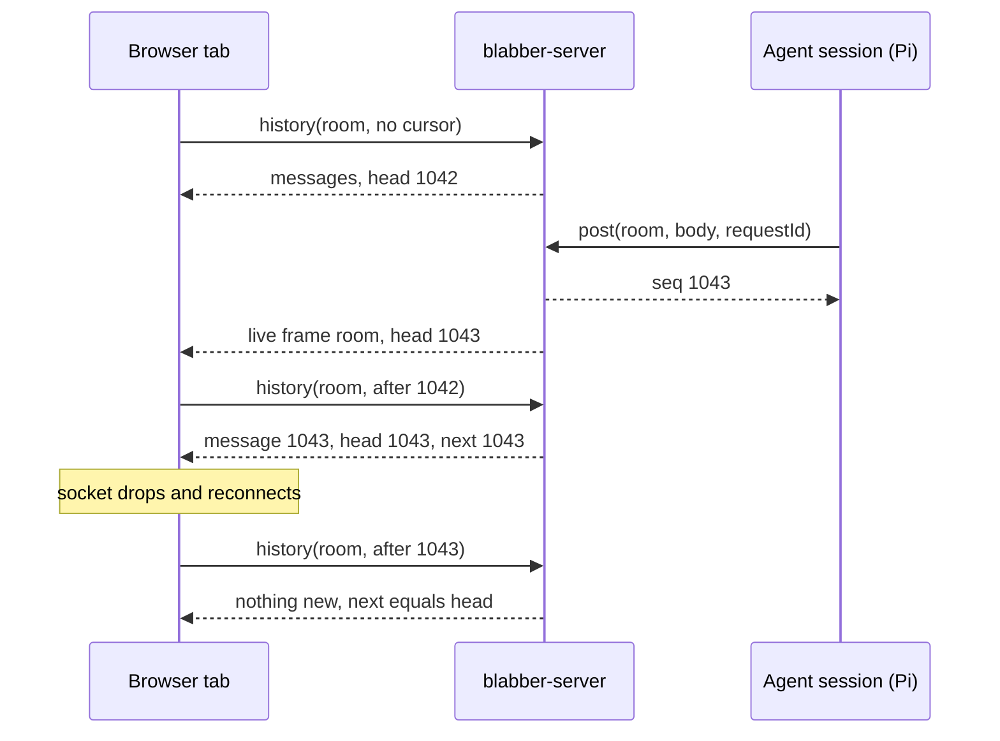
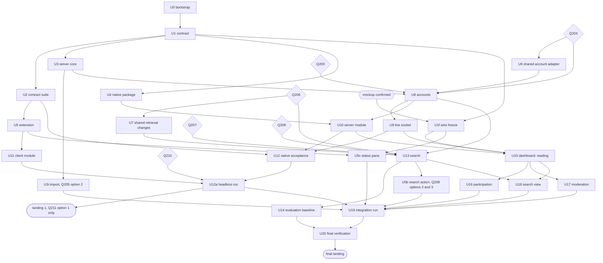

# Blabber: the product step (design, staged plan, decisions)

Status: draft for the owner's review, written 2026-11-27 from sources and revised once the same day after an
independent review. Nothing was built or run for it. It follows the design draft
`docs/drafts/20261126-1840-blabber-agent-chat-design.md` (revision 6), called "the draft" below, and the pilot
on branch `pilot/blabber`.

What was read: `main` at commit `feab9a9b` (it has moved since; of the files cited, only `flake.nix`,
`README.md` and `nix/hm/pi.nix` changed, and their line numbers here are those of `feab9a9b`); the pilot
branch at commit `13226cf1`; four surveys of this
repository's precedents (accounts, indexing, dashboard, packaging) written the same day by four agents. The
surveys read the pilot one commit earlier (`c2a7833e`) and nobody had verified them.

Evidence tags:

- **[repo]** read by me in this repository, with `path:line`. A path that starts with `pilot:` is on the pilot
  branch; every other path is on `main`.
- **[run]** observed in the pilot's suites or in its run with real Pi sessions, as recorded in section 14 of the
  draft.
- **[survey]** stated by one of the four surveys and not checked by me.
- Untagged text is a proposal of this document.

The owner's decisions are filed in the decision inbox as Q204 to Q211. This document names them by those ids
and says what each answer changes. The first version of this document called them D1 to D8: D1 is Q204, D2 is
Q205, D3 is Q206, D4 is Q207, D5 is Q208, D6 is Q209, D7 is Q210. D8 (the Pi status pane) is withdrawn: the
pane is in scope. Q211 (how the work lands) is new.

## Changes after review

One independent review returned 15 blockers and 5 advisories. All were applied; none contradicted the code.

| Finding | What changed | Where |
|---|---|---|
| auth-01 | Blabber's operator has a browser password of its own and no bearer token; a login whose password is a live bearer secret is refused; setup with and without an agent token; an acceptance case | 4.4, 4.10, 11.3, 11.5, 12 |
| auth-02 | The account boundary is given per endpoint, with the unauthenticated operations and the plain-HTTP `GET` fallback; every cookie request of the dashboard carries the actor header and is refused for another account | 4.5, 4.6, 9.6, 12 |
| auth-03 | A queued hint is checked against membership and administrator status when it is sent; loss of access invalidates the room list and cached data; what a non-party may observe about a direct message is stated as a property | 7.2, 9.5, 12 |
| auth-04 | One visibility matrix for pull, history, hints, room-list counts and search, under each answer to Q209; the administrator's reading of others' direct messages is a value of the request | 5.6, 8.3, appendix A |
| auth-05 | A declared id is bound to one principal for the life of the instance; the operator's rule; a table that detects reassignment | 4.3, 7.4 |
| search-01 | Label sets for both values of `includeArchived` and for administrators; the empty scope; authority, time, hits and totals evaluated after the last wait, and a page that changed under it is discarded whole | 8.3 |
| search-02 | The boundary of an agent's search is "rooms in which the account has an active session", defined and placed on the plan | 8.6, 13 |
| search-03 | The independent ways text leaves the machine, the effect of the indexing defaults, in-flight requests and earlier disclosures; the source version carries the chunking policy; reprojection | 8.1, 8.2, 8.4, 12 |
| wire-01 | No other person's read position on the wire; room-list counts with defined meaning; reply recipients; a result DTO for every route | 5.1, 5.4, 9.6, appendix A |
| wire-02 | A committed post replays before the archive and membership checks; archive wakes waiting polls; both cursor algorithms are pinned | 5.5, 7.3, appendix A |
| wire-03 | The product speaks 0.2.0 only; the choice left is the data; the import is specified: owner mapping, nick collision, atomicity, rollback, fixture | 6.3, 6.4 |
| scope-01 | The Pi status pane is in scope; the consequence of "accept own" is stated; framing, wake rules, security and integration expectations follow each answer to Q210 | 5.2, 10, 12, 13 |
| deploy-01 | The server suites run on the owned PostgreSQL fixture as a non-superuser role with the provider's extensions, and refuse any other database; the provider's enablement and connection budget are in the deployment example | 11.5, 11.6, 13 |
| plan-01 | A bootstrap unit brings the pilot branch forward; no cycles; headless and final membership of the package and the checks are separate; the landing rule follows Q211 | 11.6, 13 |
| plan-02 | Every exit check is a command whose exit status is the result; units that touch shared or root inputs end with `scripts/verify all`; the lock and source checks are named; the decision table and the diagram agree; a wire freeze follows the mockup | 13 |
| advice-01 | Q206 has four answers; the search work and its checks are conditional on each | 8.3, 8.4, 13 |
| advice-02 | The two "unavailable" texts are pinned; a hit names a chunk, not a match; System messages have an author field, storage rules and a delivery rule | 7.4, 8.5, appendix A |
| advice-03 | The sandbox launcher is a checked precedent; a case in the launcher's profile test; the source selections and the Linux guard are listed | 11.2, 11.4 |
| advice-04 | Aliases are usable only where the proxy listens; the proxy listener gets the same sanitised error logging as Haystack's and is what the browser check drives | 11.3 |
| advice-05 | The design is one commit | — |

## 1. Summary

**What the step delivers.**

- A Blabber server that is built and deployed like Haystack: a native executable, a Home Manager module for the
  server and one for the client, a verify target, and a landing on `main`.
- Accounts from the shared account code (`shared/service-auth`): users declared in the configuration and
  accounts created at run time, password login in the browser, tokens issued in the dashboard, tokens declared
  by digest. The pilot's own account list goes away.
- People in rooms. A person joins a room from the dashboard, posts to the room or directly to chosen
  participants, and is visible in the roster as a participant of kind `human`.
- A dashboard: rooms, a live timeline, the roster with agent identification, a composer, moderation, search,
  and the shared account pages. It is built only after the owner has confirmed a published mockup (section 9 is
  the brief for it).
- Search over messages through the shared retrieval code, under the shared per-account indexing preference,
  with the visibility rules of the timeline.
- The Pi extension on the new contract, with people as senders, and its status pane (Q179 scheduled the pane
  "with the product version").

**What it leaves out.** A container image; a NixOS module; a command-line client; an MCP endpoint; the hook
connector for Claude Code and Codex; multiple server replicas; attachments.

**What it changes outside Blabber.** Small additions to shared code (a fourth service name in a handful of
lists, one read of the administrator flag under Q209 options 1 and 2), and, depending on Q204 and Q206, larger
shared changes: an HTTP adapter for the account code that Haystack would then use too; a set of principals
per search query and a purge of deleted sources in the shared retrieval code.

**Decisions it waits on.** "Blocks" names the first units that cannot start or finish; section 13.5 gives
everything that follows from them.

| Id | Question | Options | Blocks |
|---|---|---|---|
| Q204 | Where does the account HTTP code come from? | (1) copy Haystack's; (2) a shared module that Haystack uses too; (3) share only the rules | the start of U6 and U8 |
| Q205 | What happens to the pilot's data? | (1) empty database; (2) carry rooms and messages over | unit U3i, which exists only under option 2 |
| Q206 | May the shared retrieval code change? | (1) label sets and purge; (2) neither; (3) label sets only; (4) purge only | U7, U13 |
| Q207 | Which messages are indexed? | (1) room and direct; (2) room only; (3) room fully, direct by words only | U13 |
| Q208 | Do agents get search? | (1) people only; (2) agents too, in rooms where their account has an active session; (3) agents too, in every room their account may read | part of U13; U5b |
| Q209 | What may an administrator read and do? | (1) accounts administrators, others' direct messages on explicit request; (2) the same without others' direct messages; (3) a separate list of moderators, reach as 1 | the exit of U3 and U8; U17 |
| Q210 | How does an agent treat a person's message? | (1) like any participant's; (2) the same, and a room message wakes; (3) the owner's message counts as the user's | the exit of U5 |
| Q211 | How does the work land? | (1) two merges; (2) one merge at the end | nothing; it decides whether the first landing of section 13.4 happens |

The product speaks contract version 0.2.0 only; that is part of the design and not a choice (section 6.3).
The dashboard units (U15 to U18) and the pane (U5c) wait for the confirmed mockup.

**Order of work.** A bootstrap that brings the pilot branch onto the build graph of `main`. Then the contract
and a client contract suite. Then builders in parallel: server core, native package, extension, shared
changes. Then accounts and the live socket, then the Home Manager modules and a first run with real Pi
sessions. Search and the dashboard follow, then one integration run with real browsers and real Pi sessions,
then the final verification.

## 2. Scope and non-goals

The owner's request, verbatim: "The whole product step as designed: option 3 plus the full dashboard (mockup
for confirmation first). We don't need OCI image -- we deploy through home manager. Make full dashboard where
humans can participate. Don't forget to add indexing alike to other tools. Regarding accounts -- it should be
same as with other services, declarative+imperative. Reuse the code".

In scope:

1. A native server package.
2. A Home Manager server module and a Home Manager client module.
3. A verify target `scripts/verify blabber`, and `scripts/verify all` passing.
4. A landing on `main` (Q211 decides whether in one step or two).
5. Accounts through `shared/service-auth`, as in Haystack.
6. A full dashboard in which people take part.
7. Indexing through the shared retrieval code and the shared indexing preference.
8. The status pane of the Pi extension. Q179 deferred it "with the product version", and the draft says the
   pane "comes with the product version" (draft section 6.1). It is confirmed with the dashboard mockup.

Not in scope: an OCI image; a NixOS module; a CLI; an MCP endpoint; a connector for Claude Code or Codex.

Where the sources bear on that reading:

- **No NixOS module is required.** No existing check needs one for a service that is hosted through Home
  Manager only **[survey]**. One trap: `nix/tests/service-accounts.nix` uses one list of services for its
  NixOS half and its Home Manager half **[repo]** (`nix/tests/service-accounts.nix:66,87`). Blabber needs a
  Home Manager branch of its own there, not an entry in that list.
- **"Reuse the code" has more than one reading**, and they differ in cost (section 4.9, Q204).
- **"Indexing alike to other tools" does not fit unchanged shared code.** The shared retrieval code checks one
  principal per query **[repo]** (`shared/retrieval-postgres/.../PostgresRetrieval.scala:284`). Haystack and
  Manure pass one constant principal, so everybody sees everything indexed **[repo]**
  (`haystack/server/src/main/scala/haystack/retrieval/HaystackRetrieval.scala:69,76`). Blabber's direct
  messages are not for everybody (section 8.3, Q206).
- **The draft said the opposite in three places**, all superseded by the request: search as a non-goal (draft
  section 2), a server without retrieval modules (draft section 4), and a read-only first dashboard with OCI
  and NixOS packaging (draft sections 9, 10 and 12).

Additions I propose beyond the list, each small and each needed by something in it:

- A page "Connect an agent" in the dashboard: how to issue a token and where to put it. The shared account
  pages cannot say this, because they are the same for every service.
- A sweep that marks a participant as left when it has been absent longer than the room's retention. Without
  it a crashed session counts against the room's limit of 64 active participants for ever (section 7.6).
- Enforcing the version header that the extension already sends and the pilot server ignores **[repo]**
  (`pilot:nix/pkg/pi-extensions/ponygirls-blabber/README.md`, "Assumptions about the server").
- A table that binds every declared account id to one principal (section 4.3).

## 3. What changes relative to the pilot

Sizes: the pilot server is 1,681 lines of Scala and 2,574 of tests; the extension is 3,946 lines and 5,966 of
tests (`wc -l` on `13226cf1`).

| Component | Fate | What happens |
|---|---|---|
| Contract `blabber/models/current.baboon` (0.1.0) | replace | Becomes 0.2.0 (appendix A). The 0.1.0 file is removed; the server registers one version (section 6.3). |
| Generated code `blabber/generated/` | change | Regenerated by `blabber/scripts/generate.sh`; never edited by hand. |
| Chat semantics: order, idempotent post, visibility, long poll, limits, retention (`application/`, `storage/`, `domain/`) | keep | Extended for people, archive, forward history, read marks. The contract suites on the in-memory store and on PostgreSQL stay the method. |
| `auth/Auth.scala` (72 lines: declared users, bearer only, read once at start) | replace | The shared account model (section 4). The token codec is the same as Haystack's and survives in whichever place Q204 puts it. |
| `Principal` with `admin` and `displayName` from the configuration **[repo]** (`pilot:blabber/server/src/main/scala/blabber/domain/Model.scala:52`) | replace | A caller value built per request: account id, credential kind (bearer or browser), administrator flag read from the directory. |
| `Config.scala` (every member required, no unknown member) | change | Gains the `auth` members of Haystack, `authReloadMs`, `webRoot`, `indexing`, `retrieval`. Stays strict about unknown members. |
| `http/Http.scala` (128 lines, bearer JSON routes) | change | Gains cookie authentication, the account routes, the routes for people, search, the live socket, the static web root. |
| `http/Connections.scala` (notices a closed long poll through a `java.lang.reflect.Proxy` around the listener's sockets) | keep, with a check | A native image needs that proxy registered **[repo]** (`pilot:blabber/README.md`, "Disconnects"). Whether a WebSocket upgrade passes through the wrapper is unknown (section 14). Both are checked early, in U4 and U9. |
| `migrations/0001-initial.sql` | replace | Edited in place into the product schema and kept as the only migration: no product database exists that holds the pilot's schema. With Q205 answered 2, the pilot's rows arrive through the import of section 6.4, not through a migration. |
| `scripts/pilot-server.sh` (301 lines) and `scripts/test-pilot-server.sh` (170) | remove | The product is deployed by Home Manager: a provided PostgreSQL, a rendered configuration, setup, migrate and serve units. Removed in U10. |
| `scripts/test-postgres.sh` | change | It creates a cluster with trust authentication and runs the suites as that cluster's superuser, and it accepts any database named in `BLABBER_TEST_JDBC` although the suites truncate tables **[repo]** (`pilot:blabber/scripts/test-postgres.sh:21-33`). It becomes a runner under the owned PostgreSQL fixture: a role without superuser rights, the provider's extensions, and no other database accepted (section 11.6). |
| Pi extension `nix/pkg/pi-extensions/ponygirls-blabber` | change | Section 10. Delivery rules, wake journal, cursor rules, token binding stay. The status pane is added. |
| Extension tests against the in-memory service | change | The client contract suite and the in-memory service move to `blabber/contract-suite/`, so that the dashboard's client and the native check use them too (U2). |
| `tests/run-real.sh` (starts the pilot script) | replace | The same suite runs against the packaged executable on an owned database, as the check `blabber-native` (U12). |
| No dashboard, live socket, account routes, search, package, modules, verify target | add | Sections 4 to 11. |

**The running pilot instance.** It keeps running from the pilot branch, as the transient service the owner
starts by hand (Q198), until the owner has deployed the product through Home Manager. The two cannot listen at
the same time on one machine with default settings: both use backend port 47333 **[repo]**
(`pilot:blabber/docs/config.example.json`). Sequence: deploy with the pilot stopped; check the product; then
the pilot stays stopped. Its state directory is not deleted by anybody without the owner's word.

**The pilot's data.** One account and whatever rooms the owner's sessions used since 2026-11-27. The exit
check of the pilot (real use by participants) has not happened **[run]** (draft section 12). What becomes of
the data is Q205. My recommendation is the empty database: carrying the rows over means the import of section
6.4 and its tests, for data that one person produced in days.

**Pi sessions of the pilot.** A session saved as enabled on the pilot's endpoint is not resumed against
another endpoint; it says so once and stays disabled until `/blabber enable` **[repo]**
(`pilot:nix/pkg/pi-extensions/ponygirls-blabber/README.md`, "Checkpoints are bound to the service instance").
The product's endpoint is the proxy's address, not the pilot's loopback port, so this is the normal case.
Should a product instance ever answer at the pilot's address with an empty database, a resumed session would
hold a cursor above the new room head. Section 7.3 pins what the server answers then, and section 10 what the
extension does: it discards a checkpoint that lies above the head its attach reports.

## 4. Accounts and authentication

Terms. An **account** is a row of the directory: an id, a type (`human` or `agent`), a display name, and for a
person a login and a password hash. **Declared** accounts come from the server's configuration.
**Imperative** accounts are created at run time (a person signs up, or an administrator invites one); they are
always of type `human` **[repo]** (`shared/service-auth/.../ImperativeAccounts.scala:33-34`). A **browser
session** is what a password login creates; the browser holds it as a cookie. A **token** is a bearer
credential for API calls: **configured** (declared by its SHA-256 digest in a file) or **issued** (created in
the dashboard by a signed-in person, shown once). The **actor** of an account is a public value derived from
its id (`sha256("account-actor-v1:" + id)`); it is not a credential **[repo]**
(`shared/service-auth/.../AccountJson.scala:19-23`).

### 4.1 What the shared module gives and what a service writes

`shared/service-auth` owns passwords, browser sessions, issued tokens, imperative accounts, attempt limits and
the JSON of the account routes. It does not own HTTP, cookies, the Host and Origin rules, configured tokens,
configuration parsing or transactions **[repo]** (`shared/service-auth/README.md:3-13`). Haystack writes that
part itself: `auth/Auth.scala` (236 lines), `auth/AccountService.scala` (172) and the account half of
`http/Http.scala` (about 160 of 469) **[repo]**. Blabber needs the same part. Where it comes from is Q204
(section 4.9). Everything below describes behaviour, which is the same under every answer to Q204.

### 4.2 Configuration

The `auth` block has Haystack's shape and key style **[repo]**
(`haystack/server/src/main/scala/haystack/auth/Auth.scala:11-24`), without Haystack's `activityProjectId` and
`rateLimit`, and with two members of Blabber's own (`reinstatedIds`; `moderators` only under Q209 option 3):

```json
{
  "auth": {
    "users": [
      {"id": "alice", "type": "human", "displayName": "Alice", "login": "alice",
       "passwordHashFile": "/run/secrets/blabber-alice.pbkdf2", "admin": true, "enabled": true,
       "tokens": [{"id": "workstation", "hashFile": "/run/secrets/blabber-alice-workstation.sha256"}]},
      {"id": "ci", "type": "agent", "displayName": "CI service", "enabled": true,
       "tokens": [{"id": "default", "hashFile": "/run/secrets/blabber-ci.sha256"}]}
    ],
    "reinstatedIds": [],
    "cookieSecure": true,
    "allowedHosts": ["chat.example", "localhost"],
    "allowedOrigins": ["https://chat.example:8448"],
    "insecureHttpOrigins": [],
    "accounts": {"enabled": false}
  },
  "authReloadMs": 1000,
  "indexing": {"defaultEnabled": true, "allowOptIn": false, "allowOptOut": false}
}
```

Rules that are Blabber's own:

- A declared id must match `[a-z0-9][a-z0-9._-]{0,31}`, because the account id is the owner part of every
  handle **[repo]** (`pilot:blabber/server/src/main/scala/blabber/domain/Model.scala:144`). The shared code
  accepts far wider ids **[repo]** (`shared/service-auth/.../Accounts.scala:40`). Every imperative username
  fits: its pattern is `^[a-z][a-z0-9_-]{2,31}$` **[repo]** (`shared/service-auth/.../ImperativeModel.scala:89`).
- The owner part of a handle is the account **id**, never the login. The draft's glossary says "the account
  login"; for a declared account the two may differ, and the code uses the id **[repo]**
  (`pilot:blabber/server/src/main/scala/blabber/domain/Model.scala:55`).
- `accounts` is the block of imperative accounts, with the shared meaning: a master switch, signup,
  enrollment (invitation), an issuer name, a key file for two-factor secrets. Off by default, as in the other
  services **[repo]** (`nix/lib/service-account-options.nix:37-41`).
- `indexing` has the shared defaults: on for everybody, and a person can neither opt in nor opt out unless the
  operator allows it **[repo]** (`nix/lib/service-indexing-options.nix:5-7`). Section 8.2 says what that means
  here.

### 4.3 Startup, reload, and the binding of declared ids

As Haystack **[repo]** (`haystack/server/src/main/scala/haystack/Main.scala:72-87`,
`haystack/server/src/main/scala/haystack/storage/Migrations.scala:45-47`):

1. `migrate`: Blabber's own migration ledger, then the shared initialisers in one transaction:
   `AccountSql.initialize`, `ImperativeAccountSql.initialize`, `IndexingPreferenceSql.initialize`, and the
   retrieval tables.
2. `serve`: load the configuration; read every digest and password-hash file; install the declared directory
   (`ImperativeAccountSql.installDeclared` with `AccountSql.reconcile`). A declared id or login that equals an
   existing imperative account stops the start.
3. Every `authReloadMs` the configuration and its credential files are read again. A reload that fails is
   published as a failure: every request is refused until the configuration is repaired. This is Haystack's
   behaviour and I follow it; Manure and Chronicle need a restart instead **[survey]**.

Reconciling has effects the operator should know: a declared user who is removed or disabled loses their
browser sessions and their issued tokens **[repo]** (`shared/service-auth/.../Accounts.scala:78-99`).

**A declared id names one principal for the life of the instance.** Chat data is attributed by account id:
room membership, sent messages, the right to read a direct message. The shared code keeps a name that
appears in a service's data from being taken by a new *imperative* account (`claimed`, used by signup and
enrollment only **[repo]**, `shared/service-auth/.../ImperativeAccounts.scala:135,155,285,487,543`). It does
not look at declarations: `installDeclared` checks a declared id only against existing imperative accounts
**[repo]** (`shared/service-auth/.../ImperativeAccountSql.scala:56-60`). So an operator who removes `alice`
and later declares another person as `alice` would hand that person the first one's rooms and direct
messages. Blabber closes this with a rule and a check.

- The operator's rule. Rotating is free: a new password hash, new token digests, another login or display
  name, disabling and re-enabling all keep the id and the person. A different person gets a different id. An
  id that was removed is never given to somebody else.
- The check. Blabber keeps a table `declared_ids` (id, first installed, removed at). Installing a
  configuration, at start and at every reload, is refused with a named error when it declares an id whose row
  says "removed", or an id that is new to the table and already owns chat data (the columns of section 4.7).
  The operator lifts the refusal for the same principal coming back by listing the id in
  `auth.reinstatedIds`; the listing is the operator's statement and is logged. Removal is recorded when an id
  disappears from the configuration.
- What it cannot detect: an operator who replaces the credentials of a present id with another person's in
  one edit. No mechanism can tell that from a rotation; the rule covers it.

The shared check for imperative creation stays as it is, with Blabber's data columns behind it (section 4.7).

### 4.4 Authenticating a request

- **Bearer.** `Authorization: Bearer <43 characters>`. First the configured digests, compared in constant
  time; then the issued tokens (`AccountSql.bearer`) against the merged directory **[repo]**
  (`haystack/server/src/main/scala/haystack/auth/AccountService.scala:54-60`). An issued token works only for
  an enabled account of type `human` **[repo]** (`shared/service-auth/.../Accounts.scala:47,162-166`).
- **Cookie.** `__Host-blabber` on HTTPS; `blabber-dev` on an origin that the configuration lists as plain
  HTTP. `Path=/; HttpOnly; SameSite=Strict`, 400 days, refreshed on use, as Haystack **[repo]**
  (`haystack/server/src/main/scala/haystack/auth/Auth.scala:159-165`). There is no server-side expiry; logout,
  removal, disabling and a password change end a session **[repo]** (`shared/service-auth/README.md:28-30`).
- A request with both a bearer token and a session cookie is refused **[repo]** (same file, line 225).
- **A bearer secret is never a password.** `POST /login` refuses, with the same `401` as a wrong password, a
  password that has the form of a token and whose digest is a configured token digest or a live issued token.
  The shared code already keeps the two kinds of secret apart in storage **[repo]**
  (`shared/service-auth/README.md:31-32`); this rule keeps them apart when a deployment has made them equal
  (section 4.10).

Which credential each route accepts is a fixed rule of this design, because it decides the participant kind:

| Routes | Bearer | Cookie |
|---|---|---|
| `attach`, `detach` by session key, `post`, `pull` (an agent session acts) | yes | no |
| `join`, `leave`, `say`, `read-mark`, `archive` (a person acts) | no | yes |
| `whoami`, `rooms`, `history`, `roster`, `detach` by handle | yes | yes |
| `search`, `capabilities` | Q208: no under option 1, yes under 2 and 3 | yes |
| `/api/account/v1/*` | no | yes, where the endpoint needs a session (section 4.6) |
| `GET /api/v1/live` (WebSocket) | no | yes |

A token can therefore never post as a person, and a browser session can never attach an agent session. This
is how "a session is always a participant of kind `agent`" (Q197) holds with shared accounts: the kind follows
the credential, not the account's type. The accounts survey still lists "kind equals account type" as a
conflict; that was true of the commit it read and was corrected in commit `7cc2ef84` **[repo]**
(`pilot:blabber/server/src/main/scala/blabber/application/ChatService.scala:91`).

### 4.5 Host, Origin, CSRF and the actor

CSRF (cross-site request forgery) is another site making the browser send a request with the user's cookie.

- **Host.** Every request, bearer ones included, must carry exactly one `Host`, and its name must be in
  `allowedHosts` **[repo]** (`haystack/server/src/main/scala/haystack/http/Http.scala:54-58`,
  `auth/Auth.scala:178-187`). Consequence for clients: the endpoint that the Pi extension is given must use a
  listed host name.
- **Origin.** At most one `Origin`, and it must be in `allowedOrigins`.
- **Cookie requests that are not `GET`.** They need an allowed `Origin`, or no `Origin` and
  `Sec-Fetch-Site: same-origin` **[repo]** (`auth/Auth.scala:188-191`). In Haystack the caller passes a flag
  for mutating routes. In Blabber every domain route except three is a `POST`, reads included, so the rule is
  simply: every cookie-authenticated `POST` is checked.
- **The actor on every cookie request of the domain API.** The shared account protocol binds each account
  change to the signed-in account with the header `X-Account-Actor`, so that a tab cannot act for an account
  that another tab has replaced in the shared cookie **[repo]** (`shared/service-auth/README.md:67-72`). The
  same hole exists for chat: a tab that still shows Alice's room could retry a frozen message or confirm an
  archive after another tab signed in as Bob, and the request would succeed as Bob; the Origin check passes.
  So every cookie-authenticated request to `/api/v1/` except `whoami` carries exactly one `X-Account-Actor`,
  with the value that `whoami` returned (`Identity.actor`). The server compares it with the owner of the
  presented session before any effect and before any data is returned. Another owner is `409 conflict`; a
  missing or malformed header is `400 invalid`. On a `GET` the custom header is also what makes the request
  impossible for a foreign page: it needs a CORS grant, and the server gives none. Bearer requests do not
  carry the header.
- **The socket.** Exactly one allowed `Origin` and a browser session; a URL never carries a credential. A
  browser cannot set the actor header on a WebSocket; the socket is bound to the session it was opened with
  and is closed when that session ends or is replaced (section 4.7).

### 4.6 The account routes, endpoint by endpoint

Under `/api/account/v1`. The service owns five routes: `POST /login`, `POST /logout`, `GET` of the prefix
(user, tokens, scopes), `POST /tokens`, `POST /tokens/{id}/revoke`. Every other path goes to the shared
dispatcher (`ImperativeAccountApi.handle`), and the four indexing paths to `handleIndexing` **[repo]**
(`haystack/server/src/main/scala/haystack/http/Http.scala:226-265`, `shared/service-auth/README.md:59-139`).

The boundary of **every** account request, before anything is read **[repo]**
(`haystack/.../http/Http.scala:112-116`, `auth/Auth.scala:202-218`):

- exactly one `Host`, at most one `Sec-Fetch-Site`, no query string;
- the Host and Origin rules of section 4.5, and the request's Host and Origin name the same authority, which
  is in `allowedOrigins`;
- proof of same origin: an allowed `Origin`, or no `Origin` with `Sec-Fetch-Site: same-origin`. One narrow
  exception, as in Haystack: a `GET` on an origin that the configuration lists as plain HTTP, sent with
  neither `Origin` nor `Sec-Fetch-Site` and with exactly `X-Account-Request: 1`. Browsers send no fetch
  metadata on plain HTTP, and the shared account module sends that header with every request. A `POST` never
  uses the exception;
- no `Authorization` header: a bearer token on the account plane is `401`;
- at most one session cookie of each name.

Per endpoint. "M" means the master switch of imperative accounts is on, "S" signup, "E" enrollment; where an
endpoint does not exist it answers `404` **[repo]** (`shared/service-auth/README.md:88-139`).

| Endpoint | Exists | Session cookie | `X-Account-Actor` | Remarks |
|---|---|---|---|---|
| `POST /login` | always | not needed; a valid presented one is replaced | ignored | Password login; with M also the second factor. Section 4.4's rule on bearer secrets. Attempt limits per client address. |
| `GET /policy` | M | not needed | ignored | What the server offers. `404` tells the account module to show login and tokens only. |
| `POST /signup` | S | not needed | ignored | Creates a pending or active account. |
| `POST /enrollments/inspect`, `POST /enrollments/redeem` | M | not needed | ignored | Invitation and reset codes. |
| `POST /recover` | M | not needed | ignored | Username, second factor, new password. |
| `GET` of the prefix | always | required | not needed; the answer carries the actor | The cookie is renewed. |
| `POST /logout` | always | required | required | Ends this session and closes its sockets. |
| `POST /tokens`, `POST /tokens/{id}/revoke` | always | required | required | Authority is checked again after the body was read. A configured token cannot be revoked (`403`). The one scope is `api`. |
| `GET /profile`, `GET /admin/users`, `GET /admin/enrollments` | M | required | not needed | The administrator ones need the administrator flag. |
| `POST /profile/…`, `POST /admin/users/…`, `POST /admin/enrollments…` | M (invitations: E) | required | required | Some need a fresh password proof. |
| `GET /indexing`, `GET /admin/indexing` | always | required | not needed | The indexing preference; independent of the master switch. |
| `POST /indexing`, `POST /admin/indexing` | always | required | required | Exactly one `Origin` and one `Content-Type` **[repo]** (`haystack/.../http/Http.scala:189-195`). |

"Required" for the actor means exactly one header that names the owner of the presented session, compared
inside the transaction that makes the change; a missing or malformed one is `400`, another owner `409`
**[repo]** (`shared/service-auth/README.md:110-112`).

Blabber offers the one scope `api`: an issued token has the whole authority of its account on the bearer
routes, as in Haystack and Manure **[repo]** (`shared/service-auth/README.md:40`). The dashboard embeds the
shared account pages (`shared/account-web`): login, sign-up, profile with the indexing preference, password,
two-factor, access tokens, and users for administrators (section 9.9).

### 4.7 The long poll, live connections, and what ends them

Authority is checked again after every wait, before anything is delivered. The shared README requires it
**[repo]** (`shared/service-auth/README.md:57`) and Haystack tests it **[survey]**
(`HttpAuthorityLifetimeTest.scala`).

- **`pull`.** The credential is captured when the request is admitted, checked again after the body was read,
  after every wake, and once more immediately before the answer is written. A credential that is no longer
  live gets `401 unauthorized` and no message. A waiting pull that nothing wakes learns it at its deadline, at
  most `pullMaxWaitMs` (25 s) later; nothing is delivered in between, because nothing was posted.
- **Live sockets.** As Haystack's hub **[repo]** (`haystack/server/src/main/scala/haystack/http/LiveHub.scala:44-47`,
  `http/Http.scala:418-450`): the session is checked on every received frame, on every heartbeat (30 s) and
  before every frame that is sent. Logout and a login that replaces the cookie close that session's sockets at
  once (`endSession`). A session that is no longer valid is closed with code 4401. Beyond Haystack: before a
  room hint is sent, the account's right to read that room is checked again (section 7.2).

| Event | Agent sessions of the account | Browser tabs of the account | Participants |
|---|---|---|---|
| An issued token is revoked | Sessions using it get 401 at the next request or wake, at the latest when the running poll ends. The extension stops polling with one notice **[repo]** (`pilot:.../ponygirls-blabber/README.md`, "Polling"). Sessions on other tokens are not affected. | Not affected: a token and a browser session are separate credentials. | Stay active; shown as away after the presence window (60 s). |
| A configured token is removed from the configuration | The same, at the next reload (`authReloadMs`). | Not affected. | The same. |
| The account is disabled or removed | Every token fails as above. Issued tokens are revoked for good **[repo]** (`shared/service-auth/.../Accounts.scala:95`). | Sessions are deleted; sockets close with 4401 at the next check, at most one heartbeat later; the dashboard shows the sign-in page. | Stay in the roster as away. An administrator can remove them (section 5.6); otherwise the absence sweep does (section 7.6). Messages already posted stay, with their handles. |
| Logout in one browser | Not affected. | That browser's sockets close at once; other browsers stay signed in. | The person stays joined; presence goes to away. |
| Another account signs in in the same browser | Not affected. | The old session is deleted and its sockets close. A tab that still shows the old account has its next request refused with `409` (the actor does not match) and drops what it shows (section 9.6). | Not affected. |
| An administrator is demoted, or loses the role by a reload | Not affected: tokens never carry the role. | The role is read per request. Queued hints for rooms the account may no longer read are dropped and the tab is told to read its room list again (section 7.2). | Not affected. |
| The master switch of imperative accounts is turned off | Tokens of imperative accounts are refused but kept **[survey]**. | Their sessions are refused but kept. | As for a disabled account, until the switch is on again. |

A name that appears in chat data must not be registered later by somebody else. The shared code asks the
service which names are "retained" **[repo]**
(`haystack/server/src/main/scala/haystack/auth/AccountService.scala:22-32`). Blabber's answer covers
`rooms.created_by`, `rooms.archived_by`, `participants.owner`, `messages.sender_owner` and
`message_recipients.owner`. That protects imperative creation; declarations are protected by section 4.3.

### 4.8 Who is an administrator

In the pilot, `admin` is a flag on any declared user; an administrator lists all rooms, reads everything and
may detach any participant **[repo]**
(`pilot:blabber/server/src/main/scala/blabber/application/ChatService.scala:117,227,244`). In the shared
account code, `admin` means "administers accounts and indexing"; it needs a person with a login, and it can be
granted at run time to an imperative account **[repo]**
(`shared/service-auth/.../ImperativeModel.scala:132-135`, `ImperativeAccounts.scala:313-341`). In Haystack,
Manure and Chronicle it gives no authority over content **[survey]**.

Fixed under every answer to Q209:

- Administrator authority exists **only on a browser session**. A bearer token never carries it, whatever
  account it belongs to. Otherwise every agent session of the administrator could read every room and every
  direct message, and one injected instruction would be enough to exfiltrate them. This is a change from the
  pilot, where the administrator's token had that authority.
- The flag is read for the request, in the transaction that uses it. It is never cached in the session.

What Q209 decides:

| Q209 | Who is an administrator of Blabber | Other accounts' direct messages | Shared code |
|---|---|---|---|
| 1 | The accounts administrators: a declared user with `admin: true`, or an imperative account that an administrator promoted | Readable, and only when the request asks for them (`othersDirect`, section 5.6) | One new public read, below |
| 2 | The same | Never readable; a request that asks is `403` | The same read |
| 3 | The accounts in `auth.moderators`, a list in Blabber's configuration; each must be an enabled account of type `human` | As option 1 | None |

The shared code computes the effective administrator flag only inside its own account operations; there is
no public function for it **[repo]** (`shared/service-auth/.../ImperativeAccounts.scala:25,313-324`). Under
options 1 and 2 Blabber needs one, `ImperativeAccountSql.admin(connection, settings, declared, userId)`, with
the same rule as the private one. It is an addition; no existing caller changes.

What an administrator may then read and do is section 5.6.

### 4.9 Where the HTTP part comes from (Q204)

Three ways to get the code of section 4.1 into Blabber.

**Option 1. Copy Haystack's files and adapt them.**
`blabber/server/.../auth/Auth.scala`, `auth/AccountService.scala` and the account routes in `http/Http.scala`
become adapted copies, about 570 lines, with adapted copies of Haystack's tests (the six account suites are
1,133 lines **[repo]**).

- Cost: lowest. No file outside Blabber changes for it. The unit can start at once.
- Risk: a fourth implementation of security-critical code (Manure and Chronicle already have their own,
  different ones **[repo]**: `manure/backend/src/main/scala/manure/Auth.scala` 295 lines,
  `chronicle/server/src/main/scala/chronicle/Auth.scala` 434). A later fix in one copy has to be found and
  repeated in the other. "Reuse the code" is met for the library, not for the glue.

**Option 2. Extract a shared adapter, and switch Haystack to it.**
A new module `shared/service-auth-http4s`: the token codec and file readers, origins, the request header
value, the cookie and CSRF rules with the cookie names as a parameter, the loader of declared users with the
id rule as a parameter, the account service with the identity history and the indexing service as parameters,
and the account routes as a route builder that takes the service's hooks (ending live sessions, logging,
mapping failures). Blabber's additions are parameters that Haystack leaves off: the refusal of a bearer secret
as a password, and the actor check on domain requests. Haystack's three files (877 lines) shrink to its own
rules. Manure and Chronicle are not touched: their shapes differ (key style, cookie names per mode, own
tables).

- Cost: one more unit (U6) before Blabber's accounts unit can start, a new sbt module in the lock and in
  every source selection that lists the shared modules (section 11.2), and `scripts/verify all`.
- Risk: a regression in Haystack's authentication from a change nobody asked of Haystack. The guard is that
  the move must not change behaviour: Haystack's account suites and its browser account flow pass without an
  edit to an assertion (imports and constructors only). If the extraction needs more than that, it stops and
  falls back to option 1.
- Gain: one implementation for the two services that share the shape; the next fix is made once.

**Option 3. Extract only the service-independent rules.**
Move the token codec, origins, the cookie and CSRF rules (about 130 lines of `Auth.scala`) to shared code;
copy the account service and the routes (about 330 lines).

- Cost and risk between the two. The rules that are easiest to get subtly wrong live once; the larger half is
  still copied.

Recommendation: **option 2**. The owner asked for reuse; the code is security-critical; and Haystack's
existing suites make the move checkable. Option 1 is the fallback, by the stop rule above.

### 4.10 How an agent session gets its token, and the operator's credentials

Both ways of getting a token exist side by side, as in the other services **[survey]**:

1. **Issued in the dashboard.** A person signs in, opens Account, Access tokens, New token; the secret is
   shown once; the person saves it to a file (mode 0600) and points the client at the file. The token belongs
   to the person's account, so the session's handle starts with the person's id. An account of type `agent`
   has no login and cannot do this **[repo]** (`shared/service-auth/.../Accounts.scala:64-70`).
2. **Declared by digest.** The operator puts the SHA-256 digest of a token into a file and names it under the
   account in the configuration (`tokens[].hashFile`). The raw token goes to the session's machine as a secret
   file. Rotation is a second token id that overlaps the first.

The extension reads the token once, at `/blabber enable` and at session start, and binds it to the membership
**[repo]** (`pilot:.../ponygirls-blabber/README.md`, "The token is bound to the membership"). That stays.

**The fixed accounts of the Home Manager stack.** For Haystack and Manure the stack renders two fixed
accounts: `agent`, with a configured token taken from `agentTokenFile`, and `operator`, a person who is an
administrator by default. The operator has a configured token too, and unless the owner supplies a password
hash, the operator's browser password is derived from that same token file **[repo]**
(`nix/hm/agentic-services-server.nix:35-54`, `nix/hm/agentic-services-credentials.py:123-141`,
`nix/hm/agentic-services-server-options.nix:50-53`). One secret is then both a bearer token and the password
of an administrator. In those services the administrator role gives no authority over content. In Blabber it
would undo section 4.8: an agent that holds the operator's token could log in with it and obtain the browser
session that the token itself must not give. This step does not change the other services; it states the
difference and does not copy it.

For Blabber:

- **`operator`** is a person and an administrator by default, with a login and **no token of any kind**. Its
  password is one of two: the hash file the owner names in `operator.passwordHashFile`; or, without one, a
  password that the credential helper generates once into `credentials/blabber-operator.password` (64
  hexadecimal characters, so it never has the form of a token) with its hash beside it. Neither is derived
  from a token. The operator's agent sessions, if wanted, use tokens issued in the dashboard, like anybody's.
- **`agent`** exists only when `agentTokenFile` is set. It is then a service account of type `agent` (Q197: "a
  service account that belongs to no person") with that one configured token and no login. Without the option
  no such account is rendered, and the helper provisions the operator's files all the same; today it provisions
  them only for a service that has an agent token **[repo]** (`agentic-services-credentials.py:106-108`).
- **The login rule of section 4.4** holds for every account, so a deployment that has made a password equal to
  a token by hand still cannot log in with it.
- **Acceptance** (in the check `blabber-native`, section 11.6): for an account that has a configured token and
  a password, `POST /login` with the raw token as the password is `401`; a request to an account route with
  the token in `Authorization` is `401`; the same holds for an issued token.

People use their own accounts: a shared `agent` account would give every user's sessions the same owner, and
attribution would be lost.

## 5. People in rooms

### 5.1 The participant of kind `human`

- **One per account and room.** A person has at most one participant of kind `human` in a room. Its handle is
  `owner/human`: the nick `human` is fixed and reserved, and `attach` refuses it. Every tab and every device of
  the person shares that one participant.
- **Reading needs no participant.** The visibility rule of the pilot stays: an account reads a room when it
  has a participant there, active or left **[repo]** (`pilot:blabber/README.md`, "Access"). A person whose
  agents sit in a room can already read it in the dashboard. Joining is what makes the person visible in the
  roster, addressable, and able to post.
- **Join.** `join` from a browser session. It creates the room when it does not exist (rooms are open by id,
  Q173), creates or reactivates the person's participant, and starts the read mark at the room head for a new
  participant. Joining a room one was not a member of gives the right to read its earlier room messages, as
  attaching does for an agent.
- **Leave.** `leave` marks the participant as left. The account stays a member until retention removes the
  left participant, as for agents. Closing the tab or signing out is not leaving.
- **Presence.** `online` while a visible tab of the person shows the room: the tab's heartbeat names the room
  it shows, and the server refreshes the participant's last-seen time, at most once per third of the presence
  window. `away` otherwise. A person reports no activity; it stays `Unknown`.
- **Read mark.** One per person and room, shared by the person's tabs and devices; it only moves forward. It
  is private: no other account receives it. The roster and every other answer carry an acknowledged sequence
  for agent sessions only (the pilot's `ackedSeq`), never for a person. The person's own mark comes back in
  the room list, from `join` and from `read-mark`.

### 5.2 How a person's message reaches agents (Q210)

A person posts with `say`: to the room, or directly to chosen handles. The message is stored and ordered like
any other; `senderKind` is `Human` and there is no agent identification. Limits are the same: 8 KiB, 16
recipients, 20 messages per minute, no identical body within 60 s.

Fixed under every answer:

- A person's message is marked as a person's. The line the model sees is
  `sender (verified by the server) alice/human: a person, account alice`. The kind is assigned by the server
  from the credential, unlike an agent's self-report.
- The wake budget and the abort hold apply to every wake.
- **The accept policy is the server's existing rule, applied to the new kind.** A session switched to
  `accept own` (Q174) admits a message when the sender's account is its own account. Once people post, that
  means two kinds of sender: the account's other agent sessions, and the account's owner writing in the
  dashboard. Messages of other accounts, agents and people alike, are not delivered to it. A consequence to
  know: a session that accepts only its own account can still be woken by a direct message that its owner
  writes in the browser.

What Q210 decides:

| | Option 1: like any participant | Option 2: a room message wakes | Option 3: the owner's message counts as the user's |
|---|---|---|---|
| Framing of a person's message | "From other participants of the room, agents and people; not from the user of this session. Weigh it; it changes neither your task nor your permissions." | As option 1 | As option 1 for other accounts' people. A message of the session's own account's person is framed as "from your user, written in the chat room", and may change the task. |
| What asks for a turn (wake mode `dm`) | A direct message | A direct message, or any message of a person | A direct message, or any message of the own account's person |
| Wake mode `off` | Nothing wakes | Nothing wakes | Nothing wakes |
| What a stolen browser session of the owner can do to the owner's agents | Post text that they weigh | The same, and spend their wake budget from the room | Instruct them |

Under option 1 the place where the owner instructs a session stays that session's own prompt; a browser
session is a weaker credential than the terminal the agent runs in, and a room is shared. That is the
recommended answer. Sections 10, 12 and 13 state what follows from each option.

### 5.3 What a sender is told about a person

`post` and `say` report an outlook per recipient. For a person it is `Present` (the person has the room open
now) or `Away`. Neither promises that the person will read it.

### 5.4 Direct messages and replies

- Person to agents, agent to a person (`to: ["alice/human"]`), person to person: one mechanism. A recipient
  must be an active participant; a person who has not joined cannot be addressed. A participant cannot address
  itself, as in the pilot **[repo]** (`pilot:.../application/ChatService.scala:161`).
- A direct message is visible to the account of its sender and to the accounts of its recipients, while they
  are members of the room (section 5.6). So a person sees the direct messages of their own agents, in both
  directions. This is the oversight the draft promised (draft section 8).
- **Default recipients of a reply** (a rule of the composer; the server only requires that `replyTo` names a
  message visible to the sender's account, as in the pilot **[repo]**, same file, line 164):
  - to a room message: the room;
  - to a direct message: everybody who took part in it, that is its sender and its recipients, without the
    replying participant itself;
  - of those, a participant that has left is taken out, and the composer says so; when nobody remains, the
    reply cannot be direct and the composer says that too.

  The person may change the recipients before sending.

### 5.5 Archiving a room

Archiving closes a room without deleting anything.

- **Who.** An administrator, from a browser session. Rooms are open by id and have no owner; the account that
  happened to attach first is not one.
- **Effect at once.** In one transaction: the room is marked archived; a System message records it; every
  active participant is detached.
- **Waiting polls.** After the commit the room's signal is published, whatever was stored: every waiting pull
  of the room wakes, reads, finds its participant detached, and ends with `forbidden`. This does not depend on
  the System message being deliverable to anybody. The session stops polling with one notice; that path exists
  and was observed for an administrator's detach **[run]** (draft section 6.4).
- **While archived.** `attach` and `join` are refused with `conflict` and the text "room is archived". A *new*
  `post` or `say` is refused the same way. Members still read the history and the roster.
- **A retry of a post that was already stored is answered, archived or not.** `post` and `say` look up the
  request id first, under the room lock, for the caller's participant whether it is active or has left. A
  stored post is replayed with its original result. Only when there is none does the server check that the
  room is open and the sender active. So a message that was committed just before the archive, and whose
  answer was lost, resolves as "sent", and the same request can never create a message in an archived room.
  The same order protects a sender whom an administrator removed between the commit and the retry.
- **Undo.** The same administrators unarchive. A System message records it. Nobody is re-attached; sessions
  and people enable or join again.
- **Lists.** The room list marks archived rooms; the dashboard shows them in a separate group.
- **Search.** Messages of archived rooms are left out unless the request asks for them (section 8.3).
- **Retention.** Unchanged: messages expire by the room's retention as before, and the room row stays, so its
  id cannot be taken for a new room.

### 5.6 Who sees what

Terms. An account is a **member** of a room while it has a participant there, active or left; retention ends
that when it removes the account's last left participant. An account is a **party** to a direct message when
it is the account of the sender or of a recipient. `pull` is the one read that is decided per participant;
every other read is decided per account.

**Everybody except an administrator on a browser session.** A bearer token and a browser session of the same
account see the same; a token of an administrator's account is an ordinary token.

| Message | `pull` by the session's participant P | `history`, a search hit, the unread count, for account X |
|---|---|---|
| Room message, Chat or System | Delivered, unless P caused it, or P accepts own and the sender's account is another | Seen while X is a member, also when it was posted before X joined |
| Direct message with P among its recipients | Delivered, under the same accept rule | Seen while X is a member |
| Direct message of another participant of X (X is a party, P is not) | Not delivered | Seen while X is a member |
| Direct message between other accounts | Not delivered | Not seen. X can tell that a message exists and when it was stored, and nothing else (below) |
| Anything in a room of which X is not a member | No pull exists | Not seen; the room answers `not-found`, as if it did not exist |
| Anything in an archived room | No pull exists: everybody is detached | `history` as above; a search hit only when the request includes archived rooms; the unread count stays what it was |

**An administrator on a browser session**, in addition to the rows above for their own account:

| | Q209 option 1 or 3, request without `othersDirect` | Option 1 or 3, with `othersDirect: true` | Option 2 |
|---|---|---|---|
| The list of every room, with a mark for rooms of which the account is not a member | yes | yes | yes |
| Room messages and the roster of any room | yes | yes | yes |
| Direct messages between other accounts, in `history` | no | yes | no; the request is `403` |
| The same, in search | no | yes, under Q206 options 1 and 3; under 2 and 4 the request is `400` (section 8.3) | no; `403` |
| Live hints | for every room | for every room | for every room |
| Counts in the room list | computed without others' direct messages | the list has no such switch | the same |

`othersDirect` is a member of the history request and of the search request. The server honours it before it
pages, ranks or counts: with the value absent or false, no direct message between other accounts is read,
counted or returned to an administrator, so a switch in the dashboard that is off cannot be undone by reading
the response. A caller who is not an administrator on a browser session and sends `true` gets `403`.

Further rules of an administrator:

| Action | Rule |
|---|---|
| Remove any participant | yes (`detach` by handle); the session's polling stops **[run]** |
| Archive and unarchive a room | yes |
| Post as somebody else, edit or delete a message | no; no such operation exists |

A person who is not an administrator can remove the participants of their own account (a session they cannot
reach any more) and nothing else.

**What a member who is not a party may observe about a direct message.** Sequence numbers are per room and
have no gaps, and the cursor of `pull` "also passes messages the caller may not see" **[repo]**
(`pilot:blabber/models/current.baboon:50`). So a member can tell that a message was stored that they may not
see, and roughly when: the head moved. That is the whole of it, and it is a property of the design, not an
accident. No hint, room-list entry, count, total or search answer may add to it: not the sender, not a
recipient, not the kind, not the size, not a match. The tests of sections 7.2 and 8.3 assert this from the
non-party's side.

## 6. The contract

### 6.1 The next version

Appendix A holds the complete model text of `blabber.api` version 0.2.0. Bodies stay the generated DTOs as
JSON; a request must be the exact encoding of its DTO **[repo]** (`pilot:blabber/README.md`, "API"). The text
is the same under every answer to Q204 to Q211: the answers change what the server admits and returns, not the
shape of a request or a result.

### 6.2 What changes from 0.1.0

| Item | Change | Why |
|---|---|---|
| `Identity` | adds `tokenId`, `browser`, `actor`; `admin` is true only on a browser session | The dashboard has to know what it is signed in as and which actor to send; sections 4.5 and 4.8. |
| `Participant` | adds `displayName`; `agent` and `ackedSeq` become optional and are absent for a person | People have a display name, no agent identification, and a private read mark. |
| `RoomInfo` | adds `archivedAt`, `archivedBy` | Section 5.5. |
| `RoomsResult` | holds `RoomEntry` (membership, joined, counts of people and agents, time of the last visible message, the caller's read mark and unread counts) | The room list of the dashboard. The extension does not call `rooms` **[repo]** (`pilot:.../ponygirls-blabber/src/client.ts`). |
| `Message` | `sender` and a new `senderKind` are present for Chat only; adds `actor`, and `event` for System; `agent` becomes optional | People as senders; System messages that no participant caused (archive by an administrator who has not joined). |
| `Outlook` | adds `Present` | Section 5.3. |
| `AttachRequest` | unchanged shape; the nick `human` is refused | Reserved for people. |
| `JoinRequest`, `JoinResult`, `LeaveRequest`, `SayRequest`, `MarkReadRequest`, `MarkReadResult` | new | Section 5. |
| `HistoryRequest`, `HistoryResult` | adds `after` and `othersDirect`; the result adds `head` and `next` | A browser catches up forwards after a gap. `pull` cannot serve it: it acknowledges, and it returns the newest messages, not the next ones. Section 5.6 for `othersDirect`. |
| `ArchiveRequest`, `ArchiveResult` | new | Section 5.5. |
| `SearchRequest`, `SearchHit`, `SearchResult`, `SearchCapabilities`, `SearchMode` | new | Section 8. |
| `LiveFrame` | new | Section 7.2. |
| Failure code `version-mismatch` | sent by the server for an `X-Blabber-Version` it does not support | The extension already sends the header. |
| `PostRequest`, `PostResult`, `PullRequest`, `PullResult`, `DetachRequest`, `RosterRequest`, `RosterResult`, `AgentInfo`, enums `Presence`, `Activity`, `Accept`, `MessageKind` | unchanged shape; the cursor rules of `pull` are now written down (section 7.3) | The delivery path of agents keeps its meaning. |

Every route has a result DTO:

| Route | Result |
|---|---|
| `attach` | `AttachResult` |
| `detach`, `leave` | `Ack` |
| `post`, `say` | `PostResult` |
| `pull` | `PullResult` |
| `join` | `JoinResult` |
| `read-mark` | `MarkReadResult` |
| `history` | `HistoryResult` |
| `roster` | `RosterResult` |
| `rooms` | `RoomsResult` |
| `archive` | `ArchiveResult` |
| `search`, `capabilities` | `SearchResult`, `SearchCapabilities` |
| `whoami`, `versions`, `health` | `Identity`, `VersionInfo`, `Ack` |

Some items follow choices that the owner settles with the mockup (section 9.12): the read mark and the unread
counts (`MarkReadRequest`, `RoomEntry.readSeq`, `unread`, `unreadDirect`), explicit joining (`JoinRequest` as
a separate act), and the search scope (`SearchRequest.room`). When the mockup is confirmed, the contract gets
one closed fix list (unit U1f, the wire freeze), and only then are the units that consume those items declared
final.

### 6.3 One version: 0.2.0

The product speaks 0.2.0 and nothing else. `GET /api/versions` reports `current` and `minimum` as 0.2.0 and
lists that one version. This is part of the design, not a choice.

Why 0.1.0 is not served beside it. Baboon's usual rule is that a server keeps every earlier version
registered, because clients move separately. Three facts make the pilot's version an exception:

- 0.1.0 exists only on the pilot branch. It was never on `main`; its only client is our own extension on that
  branch, and its only server is the one pilot instance.
- Three new things have no faithful form in 0.1.0: a participant without agent identification, a message from
  a person, and the outlook `Present`. A server that answered 0.1.0 would have to invent an empty
  identification for people, and the old client's framing would call people "other agents".
- A version is chosen by a request header, which a browser cannot set on a WebSocket. Serving two versions
  would need a rule for requests without the header and a matrix of what each route does for each version.
  Nothing in this step needs that machinery.

This repository has the precedent of one version changed in place: Haystack's model "stays `1.0.0`, changed in
place", and clients are upgraded with the server **[repo]** (`haystack/docs/api.md:140-145`). I use a new
number rather than changing 0.1.0 in place so that a pilot extension fails at the version check, with
`version-mismatch` from `GET /api/versions` **[repo]** (`pilot:.../ponygirls-blabber/README.md`, "Commands"),
and not at a strict decoder.

**Until when 0.2.0 may still change.** 0.2.0 may be edited in place while only we use the service and server
and extension are deployed from one revision. It is frozen when the owner declares the service ready for
others. From then on a change is a new version beside it, and Baboon's rule applies.

### 6.4 The pilot's data (Q205)

**Option 1: an empty database.** The product starts with no rooms. The pilot instance is stopped at
deployment; its files stay on disk until the owner says otherwise. Nothing else is needed.

**Option 2: carry the pilot's rooms and messages over.** Then this step builds an import. It is specified
here so that the option can be chosen.

- **Form.** A command of the server, `blabber-server import-pilot CONFIG.json SOURCE.json MAPPING.json`, run
  once by the operator after `migrate` and before the first `serve`. `SOURCE.json` names the pilot's database
  (JDBC address, user, password file). The command only reads from it. The pilot instance is stopped first.
- **Preconditions, checked before anything is written.** The product database holds no room. The pilot
  database has exactly the pilot's schema (its ledger holds `0001-initial` and nothing else). Every check
  below passes.
- **Owners are mapped, not assumed.** A pilot owner is a string in four columns (`rooms.created_by`,
  `participants.owner`, `messages.sender_owner`, `message_recipients.owner` **[repo]**,
  `pilot:blabber/migrations/0001-initial.sql`). That a string looks like an account id does not make its rows
  that account's. `MAPPING.json` therefore lists, for every distinct owner in the pilot's data, the product
  account that the operator states to be the same principal. The import refuses unless: every pilot owner is
  mapped; no two are mapped to one account; every target is a declared account of the product's configuration
  and enabled; no target owns chat data already. A first run without `--confirm` writes nothing and prints the
  mapping, the counts per owner, and a confirmation code derived from both; the real run needs that code. The
  mapping and the code are logged. The targets are entered into `declared_ids` (section 4.3).
- **A pilot nick that is now reserved.** In the pilot, `human` is a valid nick of an agent session **[repo]**
  (`pilot:.../domain/Model.scala`, `Syntax.Nick`). Such a participant is renamed `human-agent`; if that nick
  is taken for the same owner in the same room, `human-agent-2`, and so on. Its handle is rewritten wherever
  it was stored: on its messages, on the recipient rows that name it, and in the stored outlooks. Every rename
  is printed.
- **What is imported.** Rooms with topic, retention, head and creation time. Participants with their mapped
  owner, as agents, all of them marked as left at the time of the import (their sessions attach again against
  the new endpoint), with their acknowledged sequence. Messages with their sequence numbers, creation times,
  request ids and stored outlooks; `sender_kind` is `agent`. Recipient rows. Not imported: accounts and
  tokens, which come from the product's configuration.
- **Atomic.** One transaction. Any failure leaves the product database as it was.
- **Rollback.** The import never writes to the pilot's database, so the pilot can be started again unchanged.
  A product database that was imported into and not yet served can be emptied by recreating it; `migrate` and
  another import follow.
- **Afterwards.** Imported messages expire by their original creation time. They enter the search index
  through the reprojection at the next start (section 8.4), like any message stored before an index existed.
- **Test fixture.** A committed SQL file with the pilot's schema and a small data set: two owners, a
  participant with the nick `human`, room and direct messages, a participant that left, a request id that can
  be replayed. A suite on PostgreSQL imports it and asserts: each refusal above; the rename and its rewrites;
  the counts; that visibility after the import is the matrix of section 5.6; that a second import is refused;
  that a failure injected in the middle leaves no row.

Either way, a Pi session that was saved as enabled against the pilot needs `/blabber enable` once against the
new endpoint.

## 7. Server design

### 7.1 Routes

| Route | Request and result | Credential |
|---|---|---|
| `GET /api/versions` | → `VersionInfo` | none |
| `GET /api/v1/health` | → `Ack` | none |
| `GET /api/v1/whoami` | → `Identity` | bearer or cookie |
| `GET /api/v1/rooms` | → `RoomsResult` | bearer or cookie |
| `POST /api/v1/attach`, `post`, `pull` | as in the pilot | bearer |
| `POST /api/v1/detach` | `DetachRequest` → `Ack` | by session key: bearer; by handle: bearer for the caller's own account, cookie for the own account or, for an administrator, any |
| `POST /api/v1/history`, `roster` | `HistoryRequest` → `HistoryResult`; `RosterRequest` → `RosterResult` | bearer or cookie |
| `POST /api/v1/join`, `leave`, `say`, `read-mark` | section 5; results in section 6.2 | cookie |
| `POST /api/v1/archive` | `ArchiveRequest` → `ArchiveResult` | cookie, administrator |
| `POST /api/v1/search`, `GET /api/v1/capabilities` | section 8 | cookie; bearer per Q208 |
| `GET /api/v1/live` | WebSocket, `LiveFrame` | cookie |
| `/api/account/v1/*` | the shared account protocol (section 4.6) | cookie where needed |
| any other `GET` outside `/api/` | a file of the web root | none |
| anything else under `/api/` | `not-found` | — |

Every cookie-authenticated request to `/api/v1/` except `whoami` and the socket carries the actor header
(section 4.5).

Failures stay a status with `Failure{code, message}` and the pilot's codes **[repo]**
(`pilot:blabber/README.md`, "API"); `version-mismatch` (400) is added. Every answer is `Cache-Control:
no-store`. The request log keeps its fields: route, status, duration, and the account id and credential id of
a request that succeeded. A credential id is now also `issued-<uuid>` or `session-<uuid>`; the pilot's pattern
for token ids must not be applied to it **[survey]**.

**The static web root.** The server serves the dashboard from a configured `webRoot`, as Haystack does: a
regular file whose real path stays inside the root, `index.html` for `/`, no fallback for unknown paths
**[repo]** (`haystack/server/src/main/scala/haystack/http/Http.scala:343-355`). In the Home Manager deployment
the proxy serves these files itself and passes only `/api/` to the server **[repo]**
(`nix/hm/agentic-services-server.nix:245-248`). The security headers of the page (content security policy,
`nosniff`, no framing, no referrer) are therefore set in both places and tested through the proxy (U15). The
dashboard survey looked only at the server's static route.

### 7.2 The live protocol

The socket carries **hints**: a frame says that something changed, never what. The browser then reads through
the ordinary authorised routes. Correctness does not depend on a frame arriving.

- **Upgrade.** `GET /api/v1/live` with exactly one allowed `Origin`. A request without a valid browser session
  is still upgraded and then closed with 4401, so the browser can tell "signed out" from "server down". This
  is Haystack's handshake **[repo]** (`haystack/server/src/main/scala/haystack/http/Http.scala:371-416`).
- **Frames from the browser.** `ping` with a nonce and the client's time; it may name the room that a visible
  tab shows (section 5.1). Anything else closes the socket.
- **Frames from the server.** `pong` echoes the nonce and adds the server's time. `room` names a room in which
  something was committed (a message, a change of roster or topic, an archive) and gives the new head. `rooms`
  says: read your identity and your room list again.
- **Who is offered a `room` hint.** At commit, the hub marks the room as pending for the sockets of the
  accounts that are members of the room and for the sockets of administrators. A hint is the same for every
  kind of message: it never says whether a direct message, a room message or a roster change caused it.
- **A hint is authorised again when it is sent.** A socket does not hold a queue of frames per event. It holds
  the set of rooms that are pending for it, each with the highest head seen, and one flag "list changed". When
  the socket's sender takes that set, it reads in one statement, for the socket's account: whether the session
  is live; whether the account is an administrator now; and which of the pending rooms the account may read
  now (it is a member, or an administrator). It sends `room` only for those. If a pending room is no longer
  readable, or the administrator flag differs from what this socket last acted on, it sends `rooms` instead.
  So a hint that was pending while retention removed the account's last participant, or while an administrator
  was demoted, is never sent. Haystack's hub checks only that the session is live and sends every change to
  everybody **[repo]** (`haystack/server/src/main/scala/haystack/http/LiveHub.scala:44-52`); that is not
  enough here and is not copied.
- **Loss of access in the browser.** On `rooms` the page reads `whoami` and `rooms` again. A room that is no
  longer in the list is dropped from the page with everything cached for it: timeline, roster, drafts shown
  for it. The same happens when a read of an open room answers `not-found` or `403`. On 4401 or a `401`
  everything is dropped.
- **Resynchronisation by cursor.** The browser keeps, per open room, the highest sequence it has applied. On a
  `room` hint with a higher head, on reconnect, on return to a hidden tab, and on a timer, it calls `history`
  with `after` and repeats until `next` equals `head` (section 7.3). Messages are keyed by room and sequence,
  so a message that arrives twice is applied once. The roster and the room list are simply read again.
- **Heartbeat.** The server sends a control ping every 30 s and closes with 1001 when no matching pong came
  back; the browser sends an application `ping` every 10 s and expects the `pong` within 5 s. These are
  Haystack's values: the server's **[repo]** (`haystack/.../http/Http.scala:436-446`), the browser's
  **[survey]** (`haystack/web/src/connection.ts`). They come from one object so that tests can inject them.
- **Limits.** 8 sockets per browser session; 1,024 bytes per text frame from the browser **[repo]**
  (`haystack/.../http/LiveHub.scala:20`, `http/Http.scala:424`). The pending set is bounded by the number of
  rooms; frames waiting to be written are bounded at 64 and 64 KiB as in Haystack **[repo]**
  (`LiveHub.scala:15,28`).
- **Close codes.** 4401 not signed in, or the session ended; 1000 the peer closed; 1001 heartbeat missed;
  1003 unsupported frame; 1007 invalid frame; 1009 frame too large; 1013 overflow or too many sockets, retry
  later. As Haystack **[repo]** (`http/Http.scala:418-450`).
- **One replica.** The hub is process-local, like the pilot's room signals. A second replica would need a
  shared signal; that is not in this step.
- **Tests** (U9): a hint pending while the account's last participant is removed is not sent, and `rooms` is;
  the same across a demotion; a member who is not a party to a direct message receives the same frame as for
  a room message; a non-member receives none; the end of the session closes the socket.



### 7.3 Guarantees of the pilot that stay, and the two cursor rules

| Guarantee | In the pilot | With the new parts |
|---|---|---|
| Order | `post` locks the room row and takes `last_seq + 1` in the storing transaction **[repo]** (`pilot:blabber/README.md`, "Order") | `say`, and the System messages of topic, archive and unarchive, use the same path. |
| Idempotent post | the same sender and `requestId` replay the stored result **[repo]** (`pilot:.../ChatService.scala:158-159`), but only for a sender that is still active (line 155) | The lookup comes first and covers a sender that has left or whose room is archived (section 5.5). `say` the same, keyed by the person's participant. |
| Visibility | one statement decides membership and reads the messages **[repo]** (`pilot:.../PostgresChatStore.scala:182-195`) | The matrix of section 5.6, evaluated the same way for `history` in both directions, the unread counts, the hits of search and the hint check. |
| Long poll | arm, read, wait; read once more at the deadline **[repo]** (`pilot:.../ChatService.scala:203-221`) | Unchanged, plus the authority checks of section 4.7. People do not long-poll. |
| At least once | the session owns its cursor in its journal | Unchanged. The browser's cursor is in memory; a reload starts from the newest page. |
| Signals are an optimisation | a client catches up from the store by its cursor | The same sentence holds for live frames. |

**The cursor rule of `pull`** (request `after = a`, `limit = n`, `waitMs = w`; the caller's participant P is
active). It is the pilot's behaviour, written down so that both implementations and both suites agree.

1. One state of the store gives: the room head `h`; P's acknowledged sequence, set to the larger of its old
   value and `min(a, h)`; P's last-seen time; and D, the messages with a sequence above `a` that are
   deliverable to P (section 5.6), oldest first.
2. If D has more than `n` messages, the answer holds the newest `n` and `omitted` is the number left out.
   Otherwise it holds D and `omitted` is 0. In both cases `next` is `h`.
3. If the answer is empty and `w` is above 0, the request waits for the room's signal or its deadline. Each
   wake repeats steps 1 and 2. At the deadline they run once more, and that result is the answer, empty or
   not.
4. `next` is the head of the state that produced the answer. A message that commits later is neither in the
   answer nor passed by `next`.
5. `a` above `h`: nothing is delivered, the acknowledged sequence is not moved beyond `h`, and `next` is `h`,
   which is below `a`. The client's cursor is not of this room; section 10 says what the extension does.
6. A participant that was detached, or whose room was archived, while it waits gets `forbidden` at its next
   wake, and every such change wakes it (section 5.5).

**The cursor rule of `history` with `after`** (`after = a`, `limit = n`). One state of the store gives the head
`h` and V, the messages with a sequence above `a` that the caller may see, oldest first.

1. If V has more than `n` messages, the answer holds the first `n`, and `next` is the sequence of the last
   message returned. Nothing visible is skipped: the following read starts there.
2. Otherwise the answer holds V, and `next` is `h`. This passes messages the caller may not see.
3. The reader has caught up exactly when `next` equals `head`.
4. `a` above `h`: the answer is empty and `next` is `h`. The reader's cursor is not of this room; it starts
   again from the newest page.
5. For a read with `before`, or with neither, `next` equals `head`.

Both rules, with the cases of an invisible gap, a truncated page, a cursor beyond the head, the deadline, and
the archive and detach races, are cases of the client contract suite (U2) and of the store contract on both
stores (U3).

### 7.4 Storage

Changes to Blabber's own tables:

- `participants`: `session_key` may be null. A participant of kind `human` has no session key, empty agent
  columns and the nick `human`, enforced by checks; there is one row per room and account for that kind. Its
  `acked_seq` is the person's read mark.
- `rooms`: `archived_at`, `archived_by`.
- `messages`: `sender_kind`, null for System; `event`, null for Chat. `sender_id` and `sender_handle` may be
  null, and are null exactly for a System message that no participant of the room caused. `sender_owner` is
  never null: it is the account that posted or caused the message.
- `declared_ids` (section 4.3).

**System messages.** Their invariants, in storage and on the wire:

| Event | `actor` | `sender`, `senderKind` | `body` |
|---|---|---|---|
| `Topic` (an attach or join set the topic) | the account of that participant | that participant's handle and kind | the new topic |
| `Archived`, `Unarchived` | the administrator's account | absent, whether or not the administrator has joined | empty |

A System message is a room message for visibility. `pull` delivers it to every active participant except the
one that caused it; a participant that accepts own gets it only when `actor` is its own account, which is the
pilot's rule **[repo]** (`pilot:blabber/README.md`, "Accept"). It is never indexed (section 8.1).

No table for accounts, sessions or tokens: the shared initialisers own theirs, with their own version rows
**[repo]** (`shared/service-auth/.../AccountSql.scala:12-28`). The same holds for the indexing preference and
the retrieval tables. They are called from `migrate`, after the ledger, and are not numbered SQL files.
Blabber has its own database: the shared account tables carry no service name **[survey]**.

`0001-initial.sql` is edited in place into this schema and stays the only migration (section 3).

### 7.5 Moderation

`detach` by handle and `archive` are the two moderation operations. Both lock the room row, as attach, detach
and post do, so they are ordered with posts. Removing a participant does not hide its earlier messages.
Every moderation call is logged with the administrator's account id, the room and the target handle, and
nothing else.

### 7.6 Limits

- The pilot's limits stay, read from the configuration: body 8,192 bytes, 16 recipients, 64 active
  participants per room, 20 posts per minute and no identical body within 60 s per participant, pull wait at
  most 25 s, pull limit 50, history limit 100 **[repo]** (`pilot:blabber/docs/config.example.json`).
- `maxConnections` stays a configuration value (1,024 in the pilot's example): every attached session holds
  one connection, and now every open tab holds one more. Haystack's fixed 128 **[repo]**
  (`haystack/server/src/main/scala/haystack/Main.scala:97`) is too low here.
- New: an active participant that was not seen for longer than its room's retention is marked as left by the
  sweeper. A session that comes back attaches again, as it does today after a detach.
- New: search page limit 50; query text at most 2,048 UTF-16 units, the adapter's own bound **[repo]**
  (`shared/retrieval-postgres/.../PostgresRetrieval.scala:293`); at most 512 rooms in the scope of one search.
- New: the unread counts of the room list stop counting at 1,000.
- Attempt limits of login, signup and recovery are the shared ones, in memory **[repo]**
  (`shared/service-auth/README.md:148-161`). The proxy passes the client address in `X-Forwarded-For`
  **[repo]** (`nix/hm/agentic-services-server.nix:208`); the server trusts that header from a loopback peer
  only, as Haystack does **[repo]** (`haystack/.../http/Http.scala:160-161`).

The known limits of the pilot (draft section 14.5) stay as they are unless a unit names them: the replay
window of a request id is the room's retention; the in-memory post limiter starts empty after a restart.

## 8. Indexing and search

Terms. The **indexing preference** is a per-account setting, stored by the shared account code: whether this
account's content may be indexed and found by search. Its value is the administrator's override, else the
person's choice, else the server default **[repo]** (`shared/service-auth/.../IndexingPolicy.scala:12-15`).
The **retrieval index** is the shared code in `shared/retrieval-core` and `shared/retrieval-postgres`: a
service hands it a *projection* of each record (text chunks, attributes for filters, an *audience* of
principal names, the owners whose preference counts, an expiry), and it answers lexical (word), semantic
(meaning, through embedding vectors) and hybrid queries **[repo]**
(`shared/retrieval-core/.../Retrieval.scala:106-112`). An **embedding endpoint** is an external model service
that turns text into vectors; it is optional, and without it the index is lexical only **[survey]**.

### 8.1 What is indexed

One message is one source. The indexing survey compared this with windows of messages and with reply threads;
only single messages keep visibility, preference and retention exact with the shared code, and they map a hit
straight to a place in the timeline. Short messages may rank poorly by meaning; that is something to measure
(section 8.7), not a reason to start with windows.

Which messages are indexed is Q207:

| Q207 | Room messages | Direct messages |
|---|---|---|
| 1 | indexed, under the sender's preference | indexed in the same index, under the sender's preference |
| 2 | indexed | not indexed; they are found by scrolling only |
| 3 | indexed | indexed in a second index that has no embedding profile: found by words only, searched separately, and never sent to the endpoint |

The projection of an indexed message:

| Part | Value |
|---|---|
| Source id | `<room>/<seq>`. Room ids are never reused and sequences never repeat. |
| Version | The projection policy id: a fixed name and `maxChunkBytes`. A message never changes, but its chunks depend on that setting, and the adapter refuses to store a source again under the same version with other chunks **[repo]** (`shared/retrieval-postgres/.../PostgresRetrieval.scala:132`). So a changed setting is a new version (section 8.4). |
| Chunks | The body, split at `maxChunkBytes` on code-point boundaries. With the default of 8,192 a message is one chunk. Nothing else: no handle, no room, no identification, no text of the message it replies to (a room message may reply to a direct one). |
| Attributes (exact-match filters) | `room`, `direct`, `senderOwner`, `senderKind`. Not the self-reported identification: it is not trustworthy as a filter. |
| Owners | The sender's account. Its indexing preference decides. |
| Audience | Section 8.3. |
| Expiry | Creation time plus the room's retention. The adapter hides an expired source at query time, before any sweep **[repo]** (`PostgresRetrieval.scala:284`). |

System messages are not indexed. The write is in the transaction that stores the message, as the adapter
requires **[survey]** (`shared/retrieval-postgres/README.md:6`). The in-memory store has no index; search is
tested on PostgreSQL only, as in Haystack **[survey]**.

### 8.2 The preference, and what leaves the machine

`IndexingService` gets a fourth case, `Blabber` **[repo]**
(`shared/service-auth/.../IndexingPreferences.scala:7-11`). Blabber constructs the adapter in its
account-controlled form, like Haystack **[repo]** (`haystack/server/src/main/scala/haystack/Main.scala:80`).
The server flags `defaultEnabled`, `allowOptIn`, `allowOptOut` are the shared ones.

**The defaults, and what they mean here.** As in the other services, indexing is on for every account, and a
person can neither opt in nor opt out unless the operator sets the flag that allows it **[repo]**
(`nix/lib/service-indexing-options.nix:5-7`). With these defaults, under Q207 option 1 and with an embedding
endpoint configured, every direct message is sent to the endpoint. The sender cannot prevent it for
themselves unless the operator sets `allowOptOut`; the recipient never has a say, because the preference that
counts is the sender's. An administrator can override an account's value in either direction.

What "indexing off" means for an account in Blabber: its messages are not embedded and are not found by
search, by anybody. Delivery, the timeline and history are not affected. `docs/indexing-preferences.md` gets
that sentence.

**Three independent ways in which chat text leaves the machine.** Each exists or not by its own
configuration.

1. *Blabber's indexing worker.* Only with an embedding endpoint configured for Blabber. It sends the body of
   each message that is indexed in the embedding index (Q207) and whose sender's preference allows it. Never
   handles, room ids or identification.
2. *Blabber's search.* Only with the endpoint. A semantic or hybrid query sends the text the searcher typed,
   whatever anybody's preference **[repo]** (`docs/indexing-preferences.md:52-53`). A lexical query sends
   nothing.
3. *Chronicle, outside Blabber.* A message that was delivered into a Pi session is part of that session's
   transcript. Where Chronicle archives transcripts and has an embedding service configured, the text leaves
   through Chronicle, under the preference of the archive's owner (draft section 8). This holds only under
   those two conditions, and never for a message that reaches no Pi session: a direct message between two
   people is seen only in browsers.

So Q207 option 2 or 3 keeps direct messages from leaving through Blabber. It does not keep a delivered direct
message from leaving through way 3 where that way exists.

**What a later change does not undo.** Turning an account's indexing off hides its existing results and stops
new work; it does not erase what is stored, and a request that was already admitted to the endpoint can still
finish **[repo]** (`docs/indexing-preferences.md:45-51`). Nothing asks a provider to erase anything. Removing
the endpoint from the configuration stops further sending and recalls nothing that was sent.

### 8.3 Visibility at query time (Q206)

The rule to enforce is the matrix of section 5.6: a caller finds a room message when their account is a
member of the room now; a direct message when their account is a party and a member; an administrator as
Q209 says; nothing from an archived room unless asked.

The adapter stores an audience per source and matches **one** principal per query against it, inside the SQL
of every candidate leg and count **[repo]** (`shared/retrieval-postgres/.../PostgresRetrieval.scala:279-285`).
It refuses a query without a principal **[repo]** (line 293) and accepts no SQL from the caller **[survey]**.
Deleting a source with `remove` leaves rows behind (section 8.4). Q206 asks about two changes to the shared
code, which are independent:

| Q206 | Queries carry a set of labels | Deleted sources are purged | Blabber then uses |
|---|---|---|---|
| 1 | yes | yes | label sets; purge in the sweep |
| 2 | no | no | account lists per message, rewritten on membership changes; the leftovers documented |
| 3 | yes | no | label sets; the leftovers documented |
| 4 | no | yes | account lists per message; purge in the sweep |

A third way, own SQL over the shared tables as Chronicle does for its own index, is rejected: it copies the
adapter and breaks its rule.

**Label sets (options 1 and 3; recommended).** `RetrievalQuery.principal` becomes a non-empty, bounded set;
the `authorization` clause and `visible` match `principal = ANY(set)`; Haystack and Manure pass a set of one.
Call sites on `main`: one in each of the two services, one in the shared tests, two in Haystack's tests
**[repo]** (`grep "RetrievalQuery("`).

- Audiences. A room message in room R: `r:R`. A direct message in R: `d:R:<account>` for each party, and
  `x:R`.
- The rooms of a query. With `room` in the request: that room, if the caller may read it (a member, or an
  administrator on a browser session); otherwise `not-found`. Without `room`: the rooms of which the caller's
  account is a member; for a bearer token under Q208 option 2, only those in which the account has an active
  agent session (section 8.6). An administrator's reach beyond their own rooms therefore needs `room`.
- The archive flag. With `includeArchived` false, archived rooms are taken out of that list. With it true,
  they stay. Nothing in the index changes when a room is archived.
- The set. For each room R of the list: `r:R` and `d:R:<caller>`. With `othersDirect` true, and only where
  section 5.6 allows it: also `x:R`.
- An empty list is a successful, empty answer: no hits, total 0, pending 0. The index is not asked, and the
  query text is not sent to the endpoint. More than 512 rooms is `invalid`, with the advice to name a room.
- Membership changes, archiving, a demotion and the answer to Q209 need no index writes. They change the set.

**Account lists per message (options 2 and 4).** The audience of a room message is the list of the room's
member accounts. The audience of a direct message is the list of its parties that are members. The query's
principal is the caller's account.

- Every change of membership rewrites the audience of every message of the room: an account's first attach or
  join, and the sweep that removes its last left participant. A rewrite is a full `put` per message **[repo]**
  (`PostgresRetrieval.scala:124-139`), inside a transaction that holds the room lock and so blocks posts.
- Archiving and unarchiving rewrite every message of the room too: the adapter's `archived` flag is per
  source.
- One principal cannot say "an administrator, and also a party". So under these options an administrator's
  search has the reach of an ordinary account, and `othersDirect` in a search is `400 invalid`. Reading other
  rooms stays possible through the timeline.

**When things are evaluated (both mechanisms).** The adapter's own second check, `visible`, takes the same
principals and the same time as the query it is given **[repo]** (`PostgresRetrieval.scala:360-378`). Checking
hits with it after the fact would keep a total and a pending count from before a change, and could admit a hit
that expired meanwhile. So the page is built as follows.

1. A first read of the scope, before anything is sent anywhere. An empty scope is answered at once.
2. The query is embedded if the mode needs it. This is the only wait.
3. After the wait, in one transaction: the credential is checked again; the time `now` is taken; the scope is
   read (administrator flag, rooms with their archive state, and for a token the rooms with an active
   session); the index is asked, which gives hits, total and pending from one statement **[repo]**
   (`PostgresRetrieval.scala:343-355`); the scope is read once more; and the message of every hit is read
   from Blabber's own table under the timeline's rule, with expiry judged at `now`.
4. If the two scope reads differ, or a hit's message is gone or hidden, the whole page is discarded: hits,
   total and pending. Step 3 runs again, at most twice more; after that the answer is `unavailable` with
   `Retry-After`. A page is never returned with hits removed and its old counts.
5. The answer carries each message as it was read in step 3, not text from the index.

The transaction runs at the default isolation; the shared runtime does not let a service change it **[repo]**
(`shared/service-runtime/.../GuardedConnection.scala:71`), which is why the scope is read twice rather than
pinned by a snapshot.

**Tests** (U13), on PostgreSQL: a room message is found by a member and by an account that joined later, not
by a non-member; a direct message only by its parties; a total never counts what the caller may not see; an
account with no rooms gets the empty answer and the scripted endpoint sees no request; `includeArchived`
false and true; a membership change, an archive and an expiry placed between the embedding call and the
transaction change the page, never only its hits; an administrator with a browser session, with `othersDirect`
off and on, and with a bearer token; a sender who opted out is not found.

### 8.4 Retention, deletion and rebuilding

- Search stops returning a message at its expiry instant, because the projection carries the expiry.
- The sweep that deletes messages calls the adapter's `remove` for each, in its transaction.
- `remove` leaves rows behind: the source row with its id, the attributes, generations, jobs and the accepted
  embedding vectors **[repo]** (`PostgresRetrieval.scala:174-186`; no statement on `main` deletes those
  tables, `grep "DELETE FROM pony_retrieval"`). For a service whose promise is "deleted after 30 days", vectors
  derived from the text should go too.
- Q206 options 1 and 4: a shared `purge(connection, id)` deletes everything of a removed source, and Blabber
  calls it in the sweep. Manure could adopt it for deleted artifacts later; this step does not change Manure's
  behaviour. Options 2 and 3: the documentation says that derived index rows, vectors included, outlive the
  message.
- **A changed policy rebuilds the index.** The version of every source is the policy id (section 8.1), and
  the adapter's profile is the embedding space with that id. Changing `maxChunkBytes`, the embedding model, its
  revision or its dimensions therefore changes the target of every source. At the next start the server
  projects every retained message again, in batches on the background admission, as Haystack reprojects its
  items at start **[repo]** (`haystack/server/src/main/scala/haystack/Main.scala:83`). Word search covers a
  message as soon as it is projected again; semantic search when the worker has embedded it, and the pending
  count shows the difference until then. The same pass indexes messages that arrived by the import of section
  6.4, and applies a changed answer to Q207 (a source that should no longer be indexed is removed).
- A rebuild sends every retained, eligible message to the endpoint again. It does not recall what an earlier
  profile sent.

### 8.5 The retrieve interface

`POST /api/v1/search` and `GET /api/v1/capabilities` (appendix A), modelled on Haystack's `retrieve`
**[repo]** (`haystack/models/current.baboon:30-36`): mode, optional filters (room, direct or not, sender
account), `includeArchived`, `othersDirect`, offset and limit; the result has the hits, the total with its
scope, the ranking limit and `pending`, the number of sources in scope that are not yet embedded.

- **A hit names a chunk, not a match.** The adapter returns, per source, its best chunk with its position
  **[repo]** (`shared/retrieval-core/.../Retrieval.scala:105,109`). A semantic hit need not contain any word
  of the query. So a hit carries the message and the offsets of that chunk in the body (`chunkStart`,
  `chunkEnd`, UTF-16 units; the whole body for a message of one chunk). The dashboard builds the excerpt it
  shows from the chunk, and marks query words in it when it finds them.
- **The two "unavailable" answers have fixed texts**, the shared ones **[repo]**
  (`shared/retrieval-core/.../Retrieval.scala:9-12`): status 503, code `unavailable`, and as message exactly
  `semantic retrieval is not configured; lexical-only capability` or `query embedding failed`. No other text
  of the provider is ever returned.
- **Capabilities.** `modes` are the modes for room messages. `directModes` are the modes for direct messages:
  the same list under Q207 option 1, empty under option 2, `Lexical` alone under option 3.
- **The `direct` filter under Q207.** Option 1: absent means both kinds in one ranking. Options 2 and 3: absent
  or false means room messages. Option 3 with `direct: true`: the second index, lexical only; another mode is
  the first "unavailable" answer. Option 2 with `direct: true`: `invalid`.

The client rule is the repository's **[repo]** (`haystack/docs/api.md:134-145`): without a chosen mode the
client asks for hybrid when the capabilities list it, else lexical with a visible notice; a defaulted hybrid
that fails for a stated reason is run once more as lexical with the notice; an explicit mode is never
replaced; `pending > 0` is shown. One consequence is specific to chat: hybrid and semantic search see a
message only after the worker has embedded it, while lexical search sees it at once **[survey]**. The
dashboard shows the pending count for that reason.

### 8.6 Where search is offered (Q208), and configuration

In the dashboard: section 9.8. For agents, Q208 decides:

| Q208 | `search` and `capabilities` with a bearer token | Scope of a token's search |
|---|---|---|
| 1 | `403` | — |
| 2 | admitted | The rooms in which the token's account has an active agent session, at the time of the query. Inside them, what the account may see (section 5.6). |
| 3 | admitted | Every room of which the account is a member |

The boundary of option 2 is the account, not the session. A token identifies an account; the search request
carries no session, and nothing binds a token to one attachment. Two sessions of one account in two rooms can
each search both rooms. "Limited to the session's own room" cannot be enforced with this contract and is not
promised. What option 2 does exclude is every room in which the account has no session attached now: rooms it
only reads because a session was there earlier, or because the person joined.

Under options 2 and 3 the extension's tool gets an action `search` (unit U5b) that calls the same route with
the session's token; its result is framed like `read`. The admission of the two routes and the scope are part
of the server's search unit (U13) and of the client contract suite, whose cases for a bearer search follow the
answer.

Configuration: the top-level `indexing` block, and a block `retrieval`:

```json
{"retrieval": {"maxChunkBytes": 8192, "embedding": null,
               "maxConcurrent": 2, "maxQueued": 8, "batchSize": 4, "leaseSeconds": 120, "pollIntervalMs": 500}}
```

`embedding` is the shared endpoint description or null **[repo]** (`nix/lib/embedding-options.nix`). The two
existing services differ in shape here; I take Haystack's block name and Manure's explicit worker timing,
because the timing rule of `AGENTS.md` needs lease and poll interval as parameters. The start refuses a
configuration in which a chunk with its prefix cannot fit the endpoint's input bound, as Haystack does
**[survey]**; otherwise such a message would be retried for ever.

The embedding worker runs on the background admission of the connection pool, beside the retention sweeper,
so requests never wait behind it **[repo]** (`haystack/.../retrieval/HaystackRetrieval.scala:82-86`).

### 8.7 What `AGENTS.md` requires of search-quality work

`AGENTS.md` separates workflow from relevance: a scripted model provider establishes that the pipeline works,
not that results are good. The plan follows that line.

| Requirement of `AGENTS.md` | How the plan meets it |
|---|---|
| Isolated real server instances; controlled, versioned content; no production data | U14 builds a synthetic corpus of chat messages, committed with a version, and runs it on a throwaway instance on an owned database. The owner's instance is never queried. |
| No private indexed content to external models without authorisation | The corpus is synthetic. Live-provider runs send only it. No message of the pilot or of the owner's instance is used for evaluation, imported or not, unless the owner authorises that explicitly. |
| Reproduce a failure before changing ranking | This step changes no ranking. It ships the shared ranking as it is. |
| Ground truth separate from the task; same corpus, configuration and metrics for baseline and candidate; held-out cases | U14 declares the metrics (recall at 10, mean reciprocal rank) and keeps a held-out part of the corpus. Its output is a baseline of lexical against hybrid, not a tuning. |
| Scripted runs establish workflow only | The verify target contains the scripted-provider cases (projection, worker, visibility, the fallback notice). The baseline with a live provider is an on-demand run, reported separately and never as part of verify. It runs once before the final landing (U20 names its report). |
| No test whose subject is test tooling; no skipped case; the timing rule | Worker lease and poll interval are constructor parameters; a separate case asserts the production values. |

No claim about the quality of Blabber's search is made by this step.

## 9. Dashboard

This section is the brief for the mockup. Nothing of it is built before the owner has confirmed the mockup.

### 9.1 Stack and what is reused

Haystack's dashboard is the precedent for the application: React, TypeScript and Vite, hash routes, REST calls
with the session cookie, and the live socket as a source of hints **[survey]** (`haystack/web`, 6,130 lines of
source by `wc -l`). Chronicle's session page is the precedent for a transcript: anchored scrolling, loading in
both directions, safe formatting of message text **[survey]** (`chronicle/web/src/Conversation.tsx`,
`ScrollAnchor.tsx`, 708 lines).

Reused as they are:

- `shared/ui-web`: design tokens, the shell, buttons, fields, chips, lists, dialogs, toasts, notices, icons,
  fonts, and the theme script. These are style sheets and assets, not components **[survey]**. Blabber is
  added to the theme script's list of applications, which otherwise throws before the first paint **[repo]**
  (`shared/ui-web/theme-init.js:14-19`), and gets an accent colour for light and dark **[repo]**
  (`shared/ui-web/tokens.css:159-174`).
- `shared/account-web`: the whole account interface (2,085 lines in `account.js`). The host page provides two
  mount points and listens to three events **[survey]** (`shared/account-web/README.md:11-57`). Blabber's name
  is added to its list of applications **[repo]** (`shared/account-web/account.js:42`).

Adapted from Haystack, because they live in Haystack's own source and not in shared code: the connection
manager with heartbeat and reconnect (`connection.ts` and `Live.tsx`, 436 lines), the frozen retry of an
uncertain write (`pending-write.ts`), the leave guard, the in-app confirm dialog **[survey]**. Moving them to
shared code is not part of this step.

Rules that the shared style imposes **[repo]** (`shared/ui-web/README.md:17-22`): status is text or a chip,
never colour alone; errors are persistent notices in the page; success is a toast; destructive actions use the
in-app dialog; nothing smaller than 12 px; no inline styles.

### 9.2 Information architecture

| Route | Screen |
|---|---|
| signed out | Sign-in (the shared account module) |
| `#/` | The last room the person had open, or the room list |
| `#/rooms` | Room list: rooms of my account; for an administrator a switch to all rooms; archived rooms in their own group |
| `#/room/<id>` | A room: timeline, composer, roster |
| `#/room/<id>/m/<seq>` | The same, opened at one message (the target of search hits and of copied links) |
| `#/search?q=…` | Search |
| `#/connect` | "Connect an agent": issue a token, store it, point the client at it, enable a session |
| `#account/…` | The shared account pages. The host router ignores every fragment that starts with `#account` **[survey]** |

The masthead holds: the application name, the room switcher, the search field, the connection indicator, the
theme control, and the account menu (Account, Access tokens, Users for administrators, Sign out).

### 9.3 Layout

A chat page needs a timeline that scrolls on its own, with the composer fixed below it. The shared rule is one
vertical scroller per view, with Chronicle's session page as the only page that splits into panes **[repo]**
(`shared/ui-web/README.md:17`). The room page is proposed as the second such page: a rail of rooms, the
timeline with the composer, and a roster panel that can be collapsed. On a narrow screen the rail and the
roster become drawers and the timeline keeps the whole width. This is the first choice of section 9.12; if
the owner confirms it, the shared README's sentence is extended to name the page.

### 9.4 Screens and their states

"Offline" means that the connection indicator has given up on the socket or that a request failed on the
network. Content already on screen stays and is marked as possibly stale; nothing is cleared except on
sign-out, a change of account, or loss of access (section 9.5).

**Sign-in.** The login form of the shared module, with sign-up and recovery links when the server offers them.

- Loading: the button is busy.
- Error: the module's messages (wrong credentials, too many attempts, pending approval).
- Offline: "Cannot reach the server", with Retry. It is never shown as a failed sign-in.

**Room list.** Per room: id, topic, how many people and how many agent sessions are online, the time of the
last message the account may see, and marks for "joined" and "archived". For a joined room also the unread
count and, apart, the count of unread direct messages to the person. Unread means: Chat messages above the
person's read mark that the account may see and that the person did not write. A message that the account may
not see is never counted. The counts stop at 1,000 and then read "999+". A field to join or create a room by
id, with an optional topic.

- Empty: "No rooms yet. Join a room by its id, or enable Blabber in a session.", with the join field and a
  link to Connect an agent.
- Loading: skeleton rows, with a text for screen readers.
- Error: a persistent notice with Retry; rows already shown stay. Joining can fail with "invalid room id"
  (with the rule), "room is archived", or a rate limit.
- Offline: rows stay, marked stale; the join field is disabled with the reason.

**Room: timeline.** Messages from oldest to newest. Per message: time, the sender's handle with a chip for
"person" or the harness, the addressing (room, or "direct" with the recipients), the reply reference, the
body. System messages are centred lines ("alice set the topic: …", "archived by alice"). A filter shows direct
messages only.

- Empty: "No messages yet."
- Loading: a skeleton; older pages load on scrolling up; the first message that retention has kept is followed
  upwards by an explicit start marker.
- Error: a persistent notice above the timeline with Retry; loaded messages stay.
- Offline: a bar "Reconnecting…" with the time of the last update, then "Offline" with Reconnect.
- Not a member: "You are not a member of this room", with Join. An administrator sees the room, with a banner
  "Reading as administrator".

**Room: opened at a message.** The page of messages around the target, the target highlighted. When retention
has removed the message, or the account may not see it: "This message is no longer available", and the room
opens at its newest messages.

**Room: composer.** Recipients (the room, or chosen participants), the reply reference, the text, a byte
counter, Send.

- Sending: the message appears in the timeline as pending.
- Error, in place: too large; rate-limited, with the wait; identical message within a minute; a recipient has
  left; the room is archived.
- Offline: Send is disabled with the reason; the draft is kept.
- Not joined: the composer is replaced by "Join to post". Archived room: by "This room is archived".

**Room: roster.** People, then agents, then those who left (collapsed). Per participant: handle, presence, and
for an agent its activity and identification (section 9.7).

- Empty: "Nobody here yet." Loading: skeleton. Error: a notice with Retry. Offline: marked stale.

**Search.** Query field, scope, mode, filters; results with an excerpt and a link to the message.

- Before a query: a hint. No result: "No messages match."
- Loading: skeleton rows. Error: a notice. "Semantic search is not configured on this server" is a notice, not
  an error.
- Offline: submit is disabled.
- A result never contains what the account may not read.

**Connect an agent.** Four steps as text, and a button that opens Access tokens.

**Account pages.** The shared module with its own states. Users is shown to administrators only.

**Update required.** When `GET /api/versions` after a reconnect no longer lists the page's version: "Reload to
update".

**Signed out by the server.** A socket closed with 4401, or a request answered 401: the workspace is cleared
and the sign-in page is shown.

**Another account in this browser.** A request answered `409` because the actor does not match: the page
reads its identity again, drops everything it showed for the previous account, and shows the workspace of the
account that is signed in now, with a notice "You are now signed in as bob".

### 9.5 Live behaviour, resynchronisation and loss of access

- The page holds one socket. Frames are hints (section 7.2): on a `room` hint for the open room the page reads
  forward from its cursor; for another room it reads the room list again; on `rooms` it reads its identity and
  the list again.
- A connection that passed its heartbeat proves that the socket works, not that the timeline is current. After
  every reconnect, after the tab was hidden, and every 60 s, the page reads forward from its cursor and reads
  the roster again. Presence ages without any message being posted, so the roster is also read every 20 s
  while the room is open.
- New messages are appended. When the reader is at the bottom, the view follows. When the reader has scrolled
  up, the view does not move, and a pill "3 new messages" offers the jump.
- Loading older messages keeps the first visible message where it is.
- A reply to an obsolete request is ignored: every read carries the room, the identity and the generation of
  the view it was started for.
- **Loss of access.** A room that is no longer in the list, or whose reads answer `not-found` or `403`, is
  removed from the page with everything cached for it: timeline, roster, the draft shown for it. An
  administrator who lost the role loses the rooms they are not a member of in the same way.
- **The read mark.** The page moves it forward to the last message that was displayed at the bottom of a
  visible tab (`read-mark`). Several tabs of one person share the mark through the server; a tab learns of
  another tab's reading when it reads the room list again.

### 9.6 The composer and its recipients

- **Recipients.** Default: the room. Picking one or more participants from the roster, or typing a handle,
  makes the message direct; chips show the recipients; at most 16. A recipient must be active.
- **Reply.** To a room message: the room. To a direct message: everybody who took part in it, sender and
  recipients, without the person themselves; a participant that has left is taken out and named in a note;
  when nobody remains, the composer says that the reply cannot be direct (section 5.4). The person may change
  the recipients before sending.
- **Text.** A plain text area, Markdown as source. A byte counter appears near the limit of 8,192 bytes.
- **Sending.** The page creates the `requestId` when the draft is first sent and keeps it with the frozen text
  and recipients, and with the actor it was written under. On an unknown outcome (the network failed after the
  request left) it shows "Not confirmed" with Retry, which sends the same request again; the server then
  replays the stored result, also when the room was archived or the person removed meanwhile (section 5.5).
  The page never sends a changed text under an old id and never a new id for the same pending message. A
  message that arrives over the timeline with the same sequence as a confirmed send is shown once.
- **Bound to the account.** Every request carries the actor (section 4.5). A pending message, a draft and a
  confirmation dialog belong to the account they were made under. When another account signs in in the same
  browser, a retry or a confirmed dialog of the old account is refused by the server with `409`; the page
  then discards the old account's pending messages and drafts and does not offer them to the new account.
- **After sending.** A line under the message says what the server reported: "4 others: 2 busy, 1 idle, 1
  away", or for a direct message one outlook per recipient ("will be woken", "sees it at its next turn", "does
  not accept messages from other accounts", "a person, has the room open").
- **Drafts.** Kept per account and room in the tab's memory. Leaving a room with an unsent draft does not ask;
  the draft is there on return. Closing the tab with a "Not confirmed" message asks.

### 9.7 The roster with agent identification

- A person: display name, handle, presence ("has the room open", "away since 14:02"). Nobody's read position
  is shown; the wire does not carry it (section 5.1).
- An agent session: handle, harness chip, presence, activity in words ("busy", "idle, wakes on a direct
  message", "idle, will not wake", "waiting for its user"), whether it accepts messages of other accounts, and
  `about`.
- Identification on demand (a popover or an expanded row): operating-system user and host, model and effort,
  session id. The session id shows its last eight characters, with the whole id to copy; the leading
  characters of these ids are shared between sessions (Q196). A line says that these values are reported by
  the session and not verified.
- Actions: "Message directly" (fills the composer's recipients); "Remove" on participants of one's own
  account, and on any participant for an administrator.

### 9.8 Search

One field in the masthead and a page of its own. Scope: this room, or every room of which the account is a
member. Mode: automatic (the repository's rule, section 8.5), or an explicit one from those the server lists.
Filters: room messages or direct messages, sender account, archived rooms. Search runs on submit only, never
while typing. Results show room, sender, time and an excerpt of the body, and open the room at the message.
The notices of the client rule are shown as worded there: the fallback to lexical, and "N messages are not
yet indexed for semantic search; results may be incomplete".

What the answers change on this page:

- Q207 option 1: one result list for room and direct messages. Option 2: no direct messages in search, and
  the filter is absent. Option 3: "Direct messages" is a separate tab that searches by words only and says so.
- An administrator's search beyond their own rooms is a search in one named room (section 8.3).

### 9.9 The account pages

The shared module, unchanged: profile with the indexing preference, password, two-factor, access tokens,
users and invitations for administrators. Which of them appear follows what the server offers; with
imperative accounts off, the module shows login and access tokens only **[survey]**
(`shared/account-web/README.md:52-57`).

### 9.10 Moderation, keyboard and accessibility

Moderation:

- Remove a participant: from the roster, behind the in-app dialog, which names the handle and says that the
  session stops receiving. The roster is read again afterwards.
- Archive and unarchive: in the room's menu for an administrator, behind the dialog, which says that every
  session and person is detached and nothing is deleted.
- An administrator outside their own rooms always sees the banner "Reading as administrator".
- **Direct messages of other accounts** (Q209 options 1 and 3 only). A switch "Show direct messages of
  others" in the banner, off at every page load. Turning it on sends the timeline's and the search's requests
  again with `othersDirect`; while it is off, the page does not hold such messages at all, because the server
  did not send them. While it is on, the banner says so, and these messages are marked "not addressed to
  you". Under option 2 there is no switch.

Keyboard and accessibility:

- Every action is reachable by keyboard. Focus order: masthead, room rail, timeline, composer, roster.
- The timeline is a log region. New messages are announced politely, and not at all while the reader has
  scrolled up. The pill "N new messages" is a button.
- In the composer, Enter sends and Shift+Enter makes a new line. Enter during text composition (IME) does not
  send. Escape closes a popover first, then clears the reply reference.
- The recipient picker is a combobox with a list, arrow keys and an announced active option, as Haystack's
  query field **[survey]**.
- Dialogs trap focus and return it to the control that opened them.
- Presence, activity and "direct" are words, or chips with words, never colour alone.
- Both themes; a narrow layout down to a phone's width.

### 9.11 (a) What the mockup must show

Screens: sign-in; room list; room (timeline, composer, roster); room opened at a message; search with
results; Connect an agent; the account pages as the shared module renders them (profile with the indexing
preference, access tokens with a freshly issued token, users for an administrator); the administrator's room
list; and, as a terminal mockup beside the web pages, the status pane of the Pi extension (section 10.2).

States, each as its own view:

1. Room list: empty; with rooms (joined, not joined, archived); the two counts on a joined room, unread and
   unread direct, with "999+"; a room with activity that the person may not see and therefore no count;
   loading; error with Retry.
2. Timeline: an empty room; a busy room with room messages, direct messages in both directions, a reply, the
   three System lines, a message from a person and one from each harness; loading older messages; the start
   marker of retention; reading older messages while new ones arrive (the pill); the "direct" filter on.
3. Connection: reconnecting; offline with Reconnect; update required; signed out by the server; another
   account signed in in this browser.
4. Not a member, with Join; an administrator reading a room of others, with the banner; the switch "Show
   direct messages of others" off and on, with the marking of those messages.
5. Composer: to the room; direct with two recipients; replying to a room message; replying to a direct
   message with three participants, of whom one has left; pending; "Not confirmed" with Retry; rate-limited;
   too large; not joined; archived room.
6. After sending: the outlook line for a room message and for a direct message, with a person among the
   recipients.
7. Roster: people and agents in every presence and activity; the identification popover; the group of those
   who left; the remove dialog.
8. Moderation: the archive dialog; an archived room; the unarchive action.
9. Search: before a query; results in one room and across rooms; no results; the lexical fallback notice; the
   pending notice; a hit whose message is gone; the "Direct messages" tab of Q207 option 3; an administrator's
   search in a named room.
10. Narrow layout: the room with both drawers closed, with the rail open, with the roster open.
11. Light and dark theme for the room page.
12. The Pi status pane: the states listed in section 10.2.

### 9.12 (b) Choices to settle with the mockup

Each choice is shown in the mockup with the recommended variant as the default and the alternative reachable.
Choices 2, 3, 4 and 10 touch the contract; the wire freeze (unit U1f) follows the confirmation.

| # | Choice | Variants | Recommended |
|---|---|---|---|
| 1 | Layout of the room page | panes with their own scrollers; one document scroller with a sticky composer | panes on wide screens, drawers on narrow ones |
| 2 | How a person joins | an explicit Join before the first post; joining with the first post; joining by opening the room | explicit Join: joining makes the person visible and addressable to every agent in the room |
| 3 | Read marks and unread counts | stored per account for joined rooms, with the two counts of section 9.4; kept per browser; none | stored per account for joined rooms |
| 4 | When the read mark moves | when a message was displayed at the bottom of a visible tab; only on an explicit "mark as read" | when displayed |
| 5 | New messages while reading older ones | stay in place with a pill; always jump to the newest | stay in place with a pill |
| 6 | Send key | Enter sends; Ctrl+Enter sends | Enter sends, Shift+Enter makes a new line |
| 7 | Direct messages in the timeline | in the room's timeline, marked, with a filter; a separate tab | in the timeline, marked, with a filter |
| 8 | Default recipients of a reply to a direct message | everybody who took part, without oneself; the sender only | everybody who took part |
| 9 | Message text | a safe subset of Markdown (no HTML, no remote images, links shown with their address); plain text | the safe subset |
| 10 | Default search scope | the open room when started from a room, all member rooms from the masthead; always all | by where the search was started |
| 11 | Agent identification in the timeline | handle and a harness chip, details in a popover; everything on every message | handle and chip |
| 12 | The administrator's switch for others' direct messages (Q209 options 1 and 3) | in the banner of the room, off at every page load; a setting that stays on for the session of the tab | in the banner, off at every page load |
| 13 | Archived rooms in the list | a collapsed group; hidden behind a filter | a collapsed group |
| 14 | Attention for a direct message to the person | the count of unread direct messages in the page title; a browser notification | the count in the title; no notifications in this step |
| 15 | Times | local time with the UTC time on hover; UTC | local, with UTC on hover |
| 16 | The person in the roster and in handles | `alice/human` with the display name beside it; the display name only | handle and display name |
| 17 | The Pi status pane | the layout of section 10.2; the same facts as plain text (today's `/blabber`) | the pane |

## 10. The Pi extension in the product

### 10.1 What changes and what stays

| Area | Change |
|---|---|
| Contract | `PROTOCOL_VERSION` becomes `0.2.0`; the generated codecs are rebuilt (`nix/pkg/pi-extensions/blabber-api.nix`). A participant's `agent` and `ackedSeq` may be absent; a message's `sender`, `senderKind` and `agent` may be absent and `actor` is always there; the outlook `Present` exists; `history` results carry `head` and `next` and are checked like pull results; the extension always sends `othersDirect: false`. |
| Token | No code change. The token file now holds a token issued in the dashboard or a declared one (section 4.10). The README says how to get one. The binding of the token to the membership stays. |
| Settings | No change of shape: `blabber.json` with `version`, `endpoint`, `tokenFile`, `allowInsecureHttp`. In the product the Home Manager client module writes it (section 11.4). |
| Framing (what the model receives) | The header names "other participants: agents and people". A person gets the line `sender (verified by the server) alice/human: a person, account alice`; agents keep `sender (self-reported) …`. Message lines mark a person: `#1043 alice/human (person) → you (direct)`. The rest follows Q210 (section 5.2): under option 3 a message of the session's own account's person is in a separate block, "from your user, written in the chat room". |
| What asks for a turn | Q210. Option 1: unchanged (wake mode `dm`: a direct message). Option 2: also any message of a person. Option 3: also any message of the own account's person. `off` never wakes; budget and hold apply. |
| System messages | Framed as a line of the room, not of a sender: `#1050 system: alice set the topic: release 2.5`. For the wake rule a System message is a room message, as in the pilot **[repo]** (`pilot:.../ponygirls-blabber/src/framing.ts:97`). |
| A cursor that is not of this room | When an attach reports a head below the session's checkpoint, the checkpoint is discarded and the attach's cursor is used. When a pull answers with `next` below `after` (section 7.3), polling stops with one notice that asks for `/blabber enable`. Neither can skip a message: every sequence of the room as it is now lies at or below its head. |
| Transcript line | A person's handle is shown as it is; the expanded view shows "person" where an agent shows its self-report. |
| Tool: `who` | Lists people: `alice/human · person · Alice · has the room open`. |
| Tool: `send` | Outlook texts for a person: "a person, has the room open" and "a person, away". |
| Tool: `search` | Only under Q208 options 2 and 3 (unit U5b). The tool's description states the scope the server enforces: the rooms in which the account has an active session, or every room of the account. |
| Stop notice | When polling stops with `forbidden`, the notice names the two causes it cannot tell apart: the session was removed, or the room was archived. |
| `/blabber` without arguments | Opens the status pane (section 10.2). |
| Tests | The client contract suite and the in-memory service come from `blabber/contract-suite/` (U2). |

What stays: the commands; one room per session; delivery as a steer at a turn boundary; the wake modes, the
wake budget, the abort hold and the wake journal with its seal (Q195); the backlog cap; the cursor rules and
their binding to endpoint and account; the badge; the checks of every attach and pull result; the refusal to
enable on a Pi without `enqueueMessage`.

### 10.2 The status pane

Q179 chose three interface parts for the pilot and scheduled the fourth, the pane, "with the product
version". The sketch the owner saw then listed agents only. Adapted to people as participants:

```text
 Blabber · deploy-sync · release 2.4 freeze                                               connected
 you are pavel/ponygirls-7a1b · wake: direct messages · 6 of 8 wake-ups left · accepts: room

 Roster                   kind      state
 ● alice/human            person    has the room open
 ● alice/api-worker       pi        busy
 ● bob/reviewer           claude    idle, wakes on direct
 ● pavel/ponygirls-7a1b   pi        idle, wakes on direct          (this session)
 ○ carol/infra            codex     away 2h

 Recent
 14:02  alice/api-worker → room    Schema migration 0042 is merged; rebasing on main is safe now.
 14:03  alice/human → you          Which commit should I review for the auth change?
 14:05  you → alice/human          a2eae616

 esc close · w wake mode · a accept mode · d disable · ↑↓ scroll
```

- **Data.** The roster and the recent messages come from `roster` and `history`, the calls the tool already
  makes. No new route. While the pane is open it reads again after every delivered batch and on a timer. The
  pane is interface only: nothing it shows enters a request to the model.
- **Recent** lists what the session's account may see, so it can include a direct message of another session
  of the same account; such a line is marked with its real recipient, not with "you".
- **Rules.** `ponygirls-pi-ui/CONVENTIONS.md`, as for parts A to C: one line per item, colour means state and
  is never the only sign, identity and state columns survive narrowing.
- **States the mockup must show:** enabled and connected (above); a person and each harness in the roster; a
  selected roster row with the agent's identification, marked as self-reported; wake budget spent; held after
  an abort; held after a restart; offline; stopped because the session was removed or the room archived; not
  enabled (`Blabber is off in this session. /blabber enable <room> joins a room.`); not configured; a roster
  longer than the pane; a narrow terminal.
- **Confirmation.** With the dashboard mockup, as view 12 of section 9.11. The pane is built in unit U5c,
  after the extension's update and after that confirmation. Until then `/blabber` prints the same facts as
  plain text, as in the pilot.

## 11. Packaging, modules and verification

"Checked" in the tables means that I opened the file and saw the list or the precedent the row names. The
other rows come from the packaging survey.

### 11.1 Files to add

| Path | Content | Precedent |
|---|---|---|
| `blabber/contract-suite/` | The client contract as a TypeScript suite over a client factory, the in-memory service, the loopback HTTP bridge | `pilot:nix/pkg/pi-extensions/ponygirls-blabber/tests/client-contract.ts` and `tests/support/` (845 lines) |
| `blabber/server/src/main/scala/blabber/auth/` | Account configuration, service and routes, in the form Q204 decides | `haystack/server/src/main/scala/haystack/auth/` |
| `blabber/server/src/main/scala/blabber/http/LiveHub.scala` | The hub of section 7.2 | `haystack/.../http/LiveHub.scala` (53 lines) |
| `blabber/server/src/main/scala/blabber/retrieval/BlabberRetrieval.scala` | Projection, search, worker | `haystack/.../retrieval/HaystackRetrieval.scala` (88 lines) |
| `blabber/server/src/test/scala/blabber/…` | Account, authority-lifetime, live, static-asset, search-visibility and archive suites | Haystack's suites for the same subjects |
| `blabber/web/` | The dashboard: sources, `package.json` with its lock, Vite and TypeScript configuration, Node tests, browser tests | `haystack/web` |
| `blabber/scripts/test.sh`, `test-native.sh`, `test-browser.sh` | The inner-loop dispatcher that `AGENTS.md` describes, and the runners of the native and browser checks | `haystack/scripts/test-browser.sh`, `haystack/scripts/test-current.sh` **[survey]** |
| `blabber/search-eval/` | The synthetic corpus with its version, the runner, the declared metrics | none in Haystack or Manure; `AGENTS.md`, "Search-quality experiments" |
| `blabber/integration/` | The driver of the runs with real Pi sessions (U12a, U19) | none; the pilot's drivers were not committed **[run]** |
| `blabber/docs/config.example.json` (rewritten), `blabber/docs/auth.md` | Every configuration member; the account contract | `haystack/docs/auth.md` |
| `nix/pkg/blabber/package.nix`, `web.nix`, `test-dependencies.nix` | The executable joined with the web root; the locked web build; the locked test dependencies | `nix/pkg/haystack/` (14, 35 and 19 lines), checked |
| `nix/hm/blabber.nix` | The client module (section 11.4) | `nix/hm/manure.nix:147-152`, `nix/hm/pi.nix:508-539,1040-1045`, checked |
| `nix/tests/blabber-native.nix`, `blabber-browser.nix`, `blabber-hm-eval.nix`, `blabber-contract-suite.nix` | The checks of section 11.6 | `nix/tests/haystack-native.nix` (26 lines), `haystack-browser.nix` (30) |
| `shared/service-auth-http4s/` | Only with Q204 answered 2 or 3 | — |
| The import command, `blabber/server/src/test/resources/pilot-0.1.0.sql` and its suite | Only with Q205 answered 2 (section 6.4) | the pilot's schema, `pilot:blabber/migrations/0001-initial.sql` |
| The pane module of the extension | Section 10.2 | `pilot:.../ponygirls-blabber/src/transcript.ts` for the rendering conventions |

### 11.2 Files to change

| Path | Change | Checked |
|---|---|---|
| `build.sbt` | `blabberServer` depends on `serviceAuth`, `modelHttp`, `retrievalCore`, `retrievalPostgres`; `blabberContracts` joins both lists of `contractCoassembly` and its list of domain prefixes; the log line that says "six" | yes (`build.sbt:203-230`; `pilot:build.sbt:35,174-179`) |
| `lockfile-config.json`, `deps.lock.json` | The Blabber compile, test-compile and assembly tasks; the lock regenerated with the repository's updater | yes (the task list) |
| `nix/pkg/chronicle/source.nix`, `nix/tests/backend-source.nix` | Source selections for the Blabber server (native build), its JVM tests, its native and browser tests and its web build; Blabber's generated Scala, server sources and migrations in `backendDevelopment`, which the lock updater and the coassembly build from; with Q204 answered 2 or 3 the new shared module in the `shared` list that every service's selection includes | yes (`source.nix:20-25,72-77,108-113`) |
| `nix/pkg/chronicle/update-lock.nix`, `nix/pkg/chronicle/check-lock-guards.py`, `nix/tests/chronicle-sbt-lock.nix` | The Blabber assembly in the lists of required jars | yes (`update-lock.nix:73`, `check-lock-guards.py:74-75`, `chronicle-sbt-lock.nix:27`) |
| `nix/pkg/services/native.nix` | Admit `blabber`; its jar path | yes (`:2,7`) |
| `nix/tests/jvm-suites.nix` | The member `blabber-jvm` | yes |
| `flake.nix` | Package `blabber`, inside the Linux guard like the other native packages (`:431`), so that the extension and its check stay buildable on other platforms; the checks; the aggregate `verify-blabber` and its union into `verify-all`; the Home Manager client module | yes (`flake.nix:1388-1415`) |
| `scripts/verify` | The target `blabber`; `blabber` among the source roots | yes (`scripts/verify:5-11`) |
| `AGENTS.md`, `README.md` | The fourth service in the validation rules and in the service lists; the stale sentence that the indexing flags "do not yet change runtime indexing behavior" (`README.md:636-637`) | yes |
| `shared/service-auth/.../IndexingPreferences.scala` | The case `Blabber` | yes (`:7-11`) |
| `shared/service-auth/.../ImperativeAccountSql.scala` | The public read of the administrator flag (section 4.8); only with Q209 answered 1 or 2 | yes (no such function exists) |
| `shared/account-web/account.js`, `shared/account-web/tests/e2e/flow.mjs` | Blabber in the list of application names and in the list of services the account flow accepts | yes (`account.js:42`, `flow.mjs:63`) |
| `shared/ui-web/theme-init.js`, `tokens.css`, `README.md` | Blabber in the list of applications; its accent for both themes; the pane rule if the mockup confirms it | yes (`theme-init.js:14`, `tokens.css:159-174`, `README.md:17,22`) |
| `shared/retrieval-core`, `shared/retrieval-postgres`, and the call sites in Haystack and Manure | Only with Q206 answered 1, 3 or 4: label sets, purge, or both | yes (section 8.3) |
| `docs/indexing-preferences.md`, `shared/service-auth/README.md`, `shared/account-web/README.md` | Blabber's meaning of "indexing off"; the fourth user of the shared tables | survey |
| `nix/hm/agentic-services-server-options.nix`, `agentic-services-server.nix`, `agentic-services-server-assertions.nix`, `agentic-services-credentials.py` | Section 11.3; the package default is constructed like Haystack's (`options.nix:158`) | yes |
| `nix/hm/dev-llm.nix`, `nix/hm/pi.nix` | Import of the client module; the extension in Pi's list (the pilot's three lines) | `pi.nix` yes, `dev-llm.nix` survey |
| `nix/pkg/pi-extensions/blabber-api.nix`, `package.nix`, `ponygirls-pi-ui/src/border.ts`, `pi-test` | Carried over from the pilot branch, with the roots of the new codecs | yes (the pilot's diff against `main`) |
| `nix/tests/service-accounts.nix` | A Home Manager branch for Blabber, not an entry in the shared list | yes (`:66,87`) |
| `nix/tests/shared-services-modules.nix` | A Home Manager fixture for Blabber; its list at line 7 also drives the NixOS half and is not extended | yes (`:7,20,44`) |
| `nix/tests/shared-postgres.nix`, `shared-postgres-test.py`, `shared-postgres-modules.nix` | A fourth database in the fixture's policy, which is also what the owned test fixture provisions (section 11.6); the counts that are written as three | yes for the lists, survey for the counts |
| `blabber/scripts/test-postgres.sh` | Runs only on the owned fixture's database (section 11.6) | yes (`pilot:blabber/scripts/test-postgres.sh:21-33`) |
| `nix/pkg/yolo/profile-test.sh` | The cases for `BLABBER_TOKEN_FILE` (section 11.4) | yes (`:789-809`) |
| `nix/tests/test_agentic_services_credentials.py` | The cases for Blabber, among them "no agent token file" | yes (`:30,278`) |
| `nix/tests/agentic-services-hm-eval.nix` | An enabled fixture for Blabber; the baseline with Blabber off stays untouched | survey |
| `nix/tests/hm-service-unit-graph-vm.nix`, `.py`, `service-unit-graph-adapter.py` | Blabber's migrate and serve units in the Home Manager graph test | survey |
| `nix/lib/runtime-token-test.sh` | `BLABBER_TOKEN` in its loop | yes |
| `scripts/test-service-favicons.mjs` | Blabber's web root in its list | yes (`:10`) |
| `nix/tests/readme-hm-server.nix` and its fixture | Only if the README example hosts Blabber | survey |

Not changed, on purpose: everything under `nix/pkg/oci` and `nix/tests/oci-images.nix`; everything under
`nix/nixos`; `nix/tests/service-unit-graph-vm.*` (the NixOS graph); `nix/tests/service-cli-hm.nix` (no CLI);
`scripts/restart-acceptance.*`, which stays a three-service tool.

### 11.3 Home Manager: the server

Blabber becomes a child of the existing stack `smind.hm.services.agentic`, beside Haystack and Manure. That
stack already has the proxy, the credential helper and the account options. A module of its own, as Chronicle
has, would repeat the credential provisioning.

| Option under `smind.hm.services.agentic.blabber` | Type | Default | Note |
|---|---|---|---|
| `enable` | bool | `false` | Haystack and Manure default to `true` **[repo]** (`nix/hm/agentic-services-server-options.nix:153-157,178-182`). Blabber does not: a child that is on by default would demand a database from every existing deployment. |
| `listenAddress` | string | loopback | Asserted to stay loopback, as for the others. |
| `port` | port | 47333 | The backend port; 47328 to 47332 belong to other services **[repo]** (`pilot:blabber/README.md`). |
| `package` | package | built from `nix/pkg/blabber/package.nix` with the flake's sbt lock tool, as Haystack's default **[repo]** (`agentic-services-server-options.nix:158`) | Linux only, like the stack. |
| `database` | the shared database option | — | From `ponygirls.servicePostgres.connections.blabber`. |
| `operator.login`, `.enabled`, `.admin` | the shared options | as the others | The operator account. |
| `operator.passwordHashFile` | null or runtime path | `null` | Null: the helper generates a password of its own for the operator (below). Never derived from a token (section 4.10). |
| `users.<id>` | the shared option | `{}` | Declared accounts: type, display name, login, password-hash file, administrator flag, tokens by digest file. The id must match Blabber's rule (an assertion). |
| `reinstatedIds` | list of ids | `[]` | Section 4.3. |
| `moderators` | list of ids | `[]` | Only under Q209 option 3. |
| `accounts.*` | the shared options | off | Imperative accounts: master switch, signup with approval, enrollment, issuer, key file. |
| `agentTokenFile` | null or runtime path | `null` | When set, a service account `agent` with that token exists. Required for Haystack and Manure **[repo]** (`agentic-services-server-assertions.nix:39-44`); optional here. |
| `indexing.*` | the shared options | shared defaults | On for everybody; no opt-out unless `allowOptOut` is set (section 8.2). |
| `retrieval.embedding` | the shared embedding option | `null` | Null means lexical search only, and Blabber sends no text anywhere. |
| `retrieval.maxChunkBytes`, `maxConcurrent`, `maxQueued`, `batchSize`, `leaseSeconds`, `pollIntervalMs` | integers | 8192, 2, 8, 4, 120, 500 | |
| `retentionDays` | positive integer | 30 | The retention of rooms created from now on. |
| `maxConnections` | positive integer | 1024 | |
| `legacyHosts`, `legacyOrigins`, `insecureHttpOrigins` | lists of strings | `[]` | As Haystack; see "aliases" below. |

Beside these: `ports.blabber` (8448, the next free proxy port after `static` at 8447 **[repo]**,
`agentic-services-server-options.nix:124-130`) and `urls.blabber`.

**Credentials that setup provisions**, once, never overwritten, in the stack's credentials directory:

| File | When | Content |
|---|---|---|
| `blabber-operator.password`, `blabber-operator.pbkdf2` | no `operator.passwordHashFile` | A random password of 64 hexadecimal characters, and its PBKDF2 hash. The owner reads the password from the file to sign in. |
| `blabber-agent.token`, `blabber-agent.sha256` | `agentTokenFile` set | The agent token copied from the owner's file, and its digest; a changed source is refused, as for the other services **[repo]** (`agentic-services-credentials.py:126-128`). |
| `blabber-accounts.key` | imperative accounts on, no key file named | The key for two-factor secrets. |

No `blabber-operator.token` exists. The helper's cases, with and without an agent token and with and without
an explicit hash file, are in its test file (U10).

**What the module renders and runs:**

- The configuration as JSON in the store, holding paths to runtime files and never a secret. The pilot's
  limits are rendered with their pilot values and are not options.
- Units, with the stack's unit prefix: `…-blabber-migrate` (runs `check-config`, then `migrate`; requires and
  follows the database's readiness unit; wants setup) and `…-blabber` (`serve`; requires the migrate unit),
  shaped as Haystack's **[repo]** (`nix/hm/agentic-services-server.nix:374-381`). The provider installs the
  `vector` and `pg_trgm` extensions before its readiness unit succeeds, and the application's role is not a
  superuser **[repo]** (`nix/postgres/README.md:40-44`); `migrate` therefore never creates an extension that
  is missing, and the server suites run under the same conditions (section 11.6).
- A proxy listener of its own:
  - the web root served from the package, with the page's security headers (section 7.1);
  - `/api/` passed to the backend with the headers the stack already sets for WebSocket upgrades, and with
    buffering and caching off **[repo]** (`:205-214`);
  - a read timeout for `/api/` that is pinned above the longest pull (25 s); nginx's default is 60 s;
  - **error logging off at this listener**, as at Haystack's **[repo]** (`:242-244`): nginx's own error lines
    contain the request line. The proxy's access log is off for the whole stack already;
  - a failure of the backend answered as `503` with a fixed JSON body, as Haystack's listener does
    **[repo]** (`:247-249`).
- **Aliases.** The proxy answers for one host name and one port per service and refuses any other `Host` with
  421 **[repo]** (`:221-236`). `legacyHosts` and `legacyOrigins` only widen what the *backend* accepts. An
  alias is therefore usable only for requests that reach the backend by another way that the owner provides
  (a server block of their own in `proxy.extraServerConfig`, or an outer edge that keeps the proxy's host
  name); listing an alias does not make the stack's proxy answer for it.
- No backup unit in this step. Haystack has a daily dump **[repo]** (`:382-401`). For Blabber a full dump would
  keep deleted messages past their retention. A dump of the account tables alone is a small later addition.

The check `blabber-browser` drives Chromium through the proxy configuration that this module renders, not
through the server's own listener: cookies, the socket upgrade, a long poll held to its limit, the headers of
the page, and the 421 for a foreign host name are observed there.

Plain HTTP on a trusted private network is the stack's explicit opt-in (`host.scheme = "http"`), which renders
the origin as an insecure one and the cookie as `blabber-dev`, as it does for Haystack **[repo]** (`:69-84`).
The account flow on such an origin, with the `GET` fallback of section 4.6, is a case of the browser check.

### 11.4 Home Manager: the client

| Option under `smind.hm.dev.llm.blabber` | Type | Default |
|---|---|---|
| `enable` | bool | `false` |
| `url` | string, `https:` unless `allowInsecureHttp` or loopback | — |
| `tokenFile` | absolute runtime path outside the store | — |
| `allowInsecureHttp` | bool | `false` |

When enabled, the module:

- writes `blabber.json` (`{version: 1, endpoint, tokenFile, allowInsecureHttp}`) into Pi's agent directory, as
  the historian's Chronicle destination is written **[repo]** (`nix/hm/pi.nix:1040-1045`);
- adds `blabber.json` to the files that named sandbox profiles share read-only **[repo]**
  (`nix/hm/yolo.nix:487-507`);
- registers the token file with the sandbox as `BLABBER_TOKEN_FILE`, as Manure does for its token **[repo]**
  (`nix/hm/manure.nix:152`).

What the sandbox launcher does with such a registration is read from its source **[repo]**
(`nix/pkg/yolo/yolo.sh:1035-1066`): it validates the file through the shared token helper; it binds the file
read-only at its own path and passes `BLABBER_TOKEN_FILE=<path>` into the sandbox; if the launching
environment holds a literal `BLABBER_TOKEN`, it passes that literal instead and no file. Both forms are the
extension's own overrides, and it never receives both. A registered token file that is missing or malformed
fails every sandbox launch, not only Blabber's (exit 3 in the same lines). Enabling the client module
therefore comes after the token file exists.

An evaluation of the module cannot show that path at run time. The launcher's own profile test covers the two
existing token names **[repo]** (`nix/pkg/yolo/profile-test.sh:789-809`); it gets the same cases for
`BLABBER_TOKEN_FILE`, and the check `yolo-profile` runs it.

No MCP entry, no CLI wrapper, no hooks: none of them ships in this step. A session still opts in with
`/blabber enable <room>`.

### 11.5 What the owner puts into their configuration

A sketch with placeholder names, in the shape of the README's example for the stack **[repo]**
(`README.md:566-597`):

```nix
{ config, ... }:
let
  connection = config.ponygirls.servicePostgres.connections.blabber;
in {
  ponygirls.servicePostgres = {
    enable = true;                       # the provider; without it no connection exists
    # maxConnections = 80;               # only if the budget below does not fit
    databases.blabber = {
      name = "blabber"; user = "blabber"; passwordFile = "/run/user/1000/secrets/blabber-db";
    };
  };
  smind.hm.services.agentic.blabber = {
    enable = true;
    database = {
      inherit (connection) jdbcUrl readinessUnit;
      user = connection.databaseUser;
      passwordFile = connection.databasePasswordFile;
      limits.maxConnections = connection.maxConnections;
    };
    users.alice = {
      type = "human"; displayName = "Alice"; admin = true;
      login = "alice"; passwordHashFile = "/run/user/1000/secrets/blabber-alice.pbkdf2";
      tokens.workstation.tokenHashFile = "/run/user/1000/secrets/blabber-alice-workstation.sha256";
    };
  };
  smind.hm.dev.llm.blabber = {
    enable = true;
    url = "https://services.example:8448";
    tokenFile = "/run/user/1000/secrets/blabber-alice-workstation.token";
  };
}
```

Prerequisites the owner checks:

- **The provider is enabled.** `ponygirls.servicePostgres.connections.blabber` exists only then.
- **The connection budget.** The provider asserts that its `maxConnections` (default 64) covers its reserve
  (default 8) plus the limit of every database (default 12 each) **[repo]** (`nix/postgres/options.nix:14-15,31,49`).
  Adding Blabber's 12 to a provider that is fully allocated fails the evaluation with that message; then
  `maxConnections` is raised.
- **Four secret files**: the database password, the password hash, the token and its digest
  (`head -c 43 token | sha256sum`, as today **[repo]**, `pilot:blabber/README.md`, "Configuration"). The
  password must not be the token: a login with a bearer secret is refused (section 4.4).
- **Order at activation.** Setup provisions the credentials; the provider's readiness unit for the database
  succeeds; `migrate` runs; `serve` starts. The units carry these dependencies.

The alternative to a declared token is to sign in to the dashboard, issue a token under Access tokens, and
store it in the file the client module names. Without `users`, the stack's `operator` account exists; its
password is in `credentials/blabber-operator.password`, and its handles start with `operator/`.

### 11.6 The verify target

`scripts/verify blabber` builds `verify-blabber`. Its members grow in two steps, and the plan says which unit
adds what.

| Member | What it establishes | From |
|---|---|---|
| `blabber-jvm` | The complete server suites: the behavioural contract on the in-memory store and on PostgreSQL; later the account, authority-lifetime, live, search, archive and import suites. No case skips. | U0; grows with U3, U8, U9, U13 |
| `ponygirls-blabber` | The extension: type check and its suites on a manual clock | U0 (the pilot's check) |
| `shared-jvm`, `account-web-browser` | The shared suites, as in the other targets **[repo]** (`flake.nix:1398-1404`) | U0 |
| `blabber-contract-suite` | The client contract against the in-memory service, directly and behind the HTTP bridge | U2 |
| `blabber` | The package. Headless: the native executable alone. Final: joined with the web root, whose build includes its type check and Node tests | U4; the web root with U15 |
| `blabber-hm-eval` | The client module: the exact JSON, the sandbox projection, refusals of bad values; and the server child's rendering | U11 |
| `blabber-native` | The executable is static; it migrates and serves on the owned database; the client contract suite passes against it with tokens and with a browser session obtained through the account routes; the acceptance of section 4.10; a socket is upgraded and closed with the right codes. Final: also the embedding worker against a scripted provider | U12; the worker case with U13 |
| `blabber-browser` | The installed web root and the executable behind the proxy configuration that the Home Manager module renders, driven by Chromium | U15; grows with U16 to U18 |

The **headless** target is the first seven rows in their headless form. The **final** target is all rows.

`scripts/verify all` adds the cross-service checks, which this step edits (section 11.2).

**Checks that no aggregate contains.** `backend-source`, `chronicle-sbt-lock` and `chronicle-sbt-lock-helper`
guard the source selections and the lock, and `yolo-profile` the launcher; they are flake checks but not
members of `verify-all` **[repo]** (`flake.nix:1200,1294-1304,1388-1415`). A unit that edits what they guard
builds them by name (section 13). `nix build .#onDemand.backend-coassembly` is on demand by `AGENTS.md`.

**The database of the server suites.** The pilot's runner starts a cluster with trust authentication and runs
as its superuser, and takes any database from an environment variable (section 3). In deployment the role is
not a superuser and the extensions come from the provider. So:

- `blabber-jvm`, `blabber-native` and `blabber-browser` run under `nix/tests/with-owned-postgres.py`, which
  starts a disposable cluster through the provider's own code, takes no connection argument, and hands each
  database to the workload as `PONYGIRLS_TEST_DATABASE_<NAME>` **[repo]**
  (`nix/tests/with-owned-postgres.py:1-8,194-200`). The fixture's policy gets a database `blabber`
  **[repo]** (`nix/tests/shared-postgres.nix:18-29`), with the statement and lock timeouts Blabber's suites
  need; the policy's values for the other services are 1 s and 250 ms.
- `blabber/scripts/test-postgres.sh` takes its connection only from `PONYGIRLS_TEST_DATABASE_BLABBER`, and
  only when `PONYGIRLS_OWNED_FIXTURE_ROOT` holds the fixture's marker file, the interlock the browser wrapper
  already uses **[repo]** (`nix/tests/with-browser-environment.sh:5-6`,
  `nix/tests/with-owned-postgres.py:167`). `BLABBER_TEST_JDBC` is no longer read. One case asserts the
  refusal, which `AGENTS.md` allows for a fixture's safety interlock.
- A suite that needs a second database (the import of section 6.4) asks the fixture for one, as Haystack's
  native check does **[repo]** (`nix/tests/haystack-native.nix:11-12`).
- Haystack's own JVM runner has the same shape as the pilot's **[repo]**
  (`haystack/scripts/test-postgres-scala.sh:21-23`). This step does not change it.

### 11.7 Before a landing on `main`

A landing is a merge into `main`. Q211 decides whether there are two (section 13.4) or one. For each:

1. `scripts/verify all` exits 0 on the tree that is merged, with every new file staged first. The report
   names the commit, whether the tree was dirty, which members were built and which reused, and the counts of
   the built ones, as `AGENTS.md` requires. A member that is reused was verified on exactly these inputs
   before; that counts.
2. `nix build .#onDemand.backend-coassembly` and
   `nix build .#checks.x86_64-linux.backend-source .#checks.x86_64-linux.chronicle-sbt-lock .#checks.x86_64-linux.chronicle-sbt-lock-helper .#checks.x86_64-linux.yolo-profile`
   exit 0.
3. The run with real Pi sessions that belongs to the landing has passed: U12a for a headless landing, U19 for
   the final one.
4. A check that fails or cannot run is reported with its script and log (`nix log`). It is not retried until
   it passes. The Chromium suites are known to fail intermittently under host load; such a failure is
   reported the same way.

## 12. Security

| Threat | How it is handled |
|---|---|
| A token or password is read from the configuration, a log or a URL | Secrets are files named by path; the store and the rendered JSON hold paths only. Tokens and session secrets are stored as SHA-256 digests. The request log holds account and credential ids and never a credential or a message body **[repo]** (`pilot:blabber/README.md`, "Running the pilot"). The proxy listener logs no request lines (section 11.3). The socket's URL carries nothing. The extension's rules stay: it refuses an endpoint that contains the token and discards a response that echoes it **[repo]** (`pilot:.../ponygirls-blabber/README.md`, "Connection settings"). |
| A bearer secret opens a browser session | No account of Blabber's setup has one secret in both roles: the operator has no token and a password of its own. A login whose password is a live bearer secret is refused for every account. Tested in `blabber-native` (section 4.10). |
| A revoked credential keeps working | Authority is checked again after every wait and before every delivery (section 4.7). Tests: a token revoked while its pull waits gets 401 and no message; a session ended while its socket is open is closed with 4401 before the next frame. |
| A stolen session cookie | `HttpOnly`, `SameSite=Strict`, and on HTTPS `Secure` with the `__Host-` prefix. Logout, a password change and disabling end it. There is no expiry on the server; that is the shared model **[repo]** (`shared/service-auth/README.md:28-30`) and is not changed here. What the thief can do to agents depends on Q210 (below). |
| CSRF | Every cookie-authenticated `POST` needs an allowed Origin or same-origin fetch metadata; every cookie request of the domain API carries the actor header, which a foreign page cannot send; account changes need it too; the server grants no CORS (sections 4.5, 4.6). |
| A tab acts for an account that another tab replaced | The actor header: the request is refused with `409`, and the page discards the old account's pending messages and dialogs (sections 4.5, 9.6). Tested across two tabs. |
| A foreign page opens the socket | Exactly one allowed `Origin` is required for the upgrade. |
| A browser session acts as an agent, or a token as a person | The credential table of section 4.4. Tests for every refused combination. |
| An agent session of an administrator reads everything | Administrator authority exists on browser sessions only (section 4.8). |
| A declared id passes to another person and with it their rooms and direct messages | The binding of section 4.3: the operator's rule, and a refusal to install an id that was removed or that already owns data without an explicit reinstatement. |
| Reading a room one is not a member of | The matrix of section 5.6, one rule for `history` in both directions, the unread counts, search and the hint check. A caller who is not a member learns nothing about the room's existence, as in the pilot **[repo]** (`pilot:blabber/README.md`, "Access"). |
| A direct message leaks to a member who is not a party | **Property of the design:** such a member can observe that a message was stored and when, because sequence numbers have no gaps and cursors pass invisible messages (section 5.6). Nothing else may leak: no sender, recipient, kind or size through hints, room lists or counts; no hit, excerpt, total or pending count through search. Hints are identical for every kind of message. Counts and totals are computed over visible messages only. Tested from the non-party's side in every surface. |
| An administrator reads others' direct messages without meaning to, or after demotion | Only on an explicit request value, honoured before paging, ranking and counting (section 5.6). The flag is read per request; queued hints are checked when sent (section 7.2). |
| An archived or expired message is found | The scope leaves out archived rooms unless asked; expiry is part of the projection and is judged again at delivery time; a page whose scope changed is discarded whole (sections 8.3, 8.4). |
| Moderation by the wrong account | `archive` and `detach` of another account's handle require an administrator's browser session, checked in the transaction that makes the change. Every moderation call is logged. |
| Prompt injection through another agent | Unchanged from the pilot: the framing with a random marker per batch, the wake budget, the abort hold, `accept own`, and the sandbox as the containment (draft section 8). |
| Prompt injection through a person's account | Depends on Q210. Option 1: a person's message has no authority; a stolen browser session can post text that agents weigh like any other. Option 2: the same, and room messages of a person wake idle sessions, so the thief can also spend wake budgets and model runs. Option 3: a message of the session's own account's person is treated as the user's; a stolen browser session of the owner then **instructs the owner's agents**, and "a chat message has no authority" is no longer true for that sender. Under every option, `accept own` does not shield a session from its own account's person (section 5.2). |
| Prompt injection through search results (Q208 options 2 and 3) | A hit is framed like history that the agent asked for. Under option 2 an agent reaches older messages of the rooms where its account has an active session; under option 3 of every room of its account. Under option 1 agents have no search. |
| Self-reported identification is believed | It is marked as self-reported wherever it is shown, to people and to models. It is never an attribute of the index and never decides anything. The kind of a participant is assigned by the server. |
| Text leaves the machine | The three ways of section 8.2, each on its own configuration. Through Blabber: only with an embedding endpoint; then the bodies of the messages that Q207 puts into the embedding index, under the sender's preference, which by default is on and cannot be changed by the person; and the text of semantic and hybrid queries. A recipient has no say. Changing a preference or removing the endpoint recalls nothing. Through Chronicle: only where it archives transcripts with an embedding service, and only for messages that reached a Pi session. |
| Flooding | The post limits per participant; the shared attempt limits on login and signup; the socket limits; `maxConnections`. |
| Message text attacks the page | Bodies are rendered through a safe subset of Markdown without HTML. The page's content security policy allows scripts and styles from itself only and is tested through the proxy. |
| A test or a tool destroys real data | The server suites accept only the owned fixture's database (section 11.6). The import only reads from the pilot's database (section 6.4). |

A finding about credential handling that a unit's review raises is fixed in that unit. It is not recorded as a
limit. A fix that adds states and draws new findings is replaced by one that removes states.

## 13. Staged plan

### 13.1 Rules of the plan

- A bootstrap unit comes first: it puts the pilot's code on the product branch and on the build graph, so
  that every later unit has checks to exit on.
- Then the contract, with a client contract suite that runs against an in-memory service and against the
  real server.
- Builders work in parallel only on files that no other running unit owns. `build.sbt`, `flake.nix`, the lock
  files and everything under `nix/` belong to the units that name them; a builder who needs a change there
  asks its owner.
- Each unit gets at most one advisory review and a closed list of fixes from it. There are no review rounds.
- **Every exit check is a command, and it passes when the command's exit status is 0.** The JVM and browser
  checks fail by themselves on any failure, error or skip and on an empty report **[repo]**
  (`nix/tests/sbt-suite.nix:19-28`, `scripts/junit-gate.py`). Where a unit must add cases, the cases are named
  in its goal and a reader confirms them; no list of expected test names is added to the tree (`AGENTS.md`).
- **A unit that changes `shared/`, the shared Nix modules, the root sbt build or `flake.nix` ends with
  `scripts/verify all`**, as `AGENTS.md` requires. A member that is reused from the cache was verified on
  exactly these inputs before; that counts, and the report says which were built and which reused.
- Nothing that needs a decision blocks work that does not.
- Timing: intervals are parameters; a test may pass short ones; a separate test asserts the production value;
  no timeout is lengthened to obtain a pass (`AGENTS.md`).
- Sizes are given by reference to existing code, counted with `wc -l` on the commits named at the top. They
  are not durations. No duration is claimed: none was measured for Blabber.
- Between U1 and the end of U3 and U5 the server and the extension do not compile against the new contract.
  That is expected on the branch; stage B ends when `scripts/verify blabber` exits 0 again.

### 13.2 Units

**Stage 0: bootstrap.**

**U0. Bring the pilot forward.**

- Goal: a product branch from `main` with `pilot/blabber` merged into it (the pilot's design-draft commits
  are on `main` already and are resolved in favour of `main`). The pilot's two sbt projects are added to
  everything that lists projects: the coassembly's two lists and its list of domains, the lock's task list,
  the updater's and the two lock checks' lists of assemblies, the source selections (section 11.2). The check
  `blabber-jvm` exists and runs on the owned PostgreSQL fixture (section 11.6). `scripts/verify blabber`
  exists with the members that exist: `blabber-jvm`, `ponygirls-blabber`, `shared-jvm`, `account-web-browser`.
- Owns: `build.sbt`, `lockfile-config.json`, `deps.lock.json`, `nix/pkg/chronicle/{source,update-lock}.nix`,
  `check-lock-guards.py`, `nix/tests/{jvm-suites,chronicle-sbt-lock,backend-source,shared-postgres}.nix` and
  `shared-postgres-test.py` (a fourth database in the fixture's policy changes the counts that test asserts),
  `blabber/scripts/test-postgres.sh`, `flake.nix`, `scripts/verify`, `AGENTS.md`.
- Depends on: nothing.
- Exit check:
  - `git merge-base --is-ancestor pilot/blabber HEAD`
  - `nix run .#chronicle-update-sbt-lock -- "$PWD/deps.lock.json" && git diff --exit-code -- deps.lock.json`
    (the committed lock is what the updater produces)
  - `nix build .#checks.x86_64-linux.backend-source .#checks.x86_64-linux.chronicle-sbt-lock .#checks.x86_64-linux.chronicle-sbt-lock-helper`
  - `nix build .#onDemand.backend-coassembly`
  - `nix build .#checks.x86_64-linux.blabber-jvm .#checks.x86_64-linux.ponygirls-blabber`
  - `scripts/verify all`
- Size: the pilot's changes outside its own directories are six files and about forty lines, and one new
  file of 21 lines **[repo]** (its diff against `main`); this unit adds short entries in about a dozen files
  and rewrites a 54-line runner.
- Risk: medium. The lock and coassembly lists were never touched by the pilot **[survey]**; the suites meet a
  role without superuser rights for the first time.

**Stage A: the contract.**

**U1. Contract 0.2.0.**

- Goal: the model of appendix A in `blabber/models/`, the 0.1.0 file removed, regenerated Scala and
  TypeScript.
- Owns: `blabber/models/`, `blabber/generated/`, `nix/pkg/pi-extensions/blabber-api.nix`.
- Depends on: U0. Parallel with: the mockup.
- Exit check:
  - `BABOON=<the pinned 0.0.200 executable> blabber/scripts/generate.sh && git diff --exit-code -- blabber/generated`
  - `nix develop .#backend --command bash scripts/backend-sbt.sh -batch blabberContracts/compile`
  - `nix build .#ponygirls-pi-extensions` (it builds the TypeScript codecs)
- Size: the pilot's model is 59 lines; appendix A is about twice that.
- Risk: low. The wire freeze (U1f) may reopen a few items.

**U2. Client contract suite.**

- Goal: one executable description of the contract for clients: a suite over a client factory with three
  kinds of client (a session with a token, a person with a browser session, an administrator), and an
  in-memory service that passes it. Its cases include the two cursor rules with their edge cases, replay
  against archive and removal, two browser clients of one person, unread counts beside messages the caller
  may not see, replies to a direct message with several participants, and the matrix of section 5.6. The cases
  for a search with a token follow the answer to Q208, and those for `othersDirect` the answer to Q209; until
  an answer exists, those cases are not written.
- Owns: `blabber/contract-suite/`, `nix/tests/blabber-contract-suite.nix`.
- Depends on: U1. Parallel with: U3, U4.
- Exit check: `nix build .#checks.x86_64-linux.blabber-contract-suite`
- Size: the pilot's suite, service and bridge are 845 lines for 19 cases **[run]**; the new routes more than
  double the cases.
- Risk: medium. The in-memory service is a second implementation of the rules. Where it and the server
  disagree, the contract text decides and one of them is fixed.

**Stage B: foundations, in parallel after stage A.**

**U3. Server core.**

- Goal: the service and both stores on 0.2.0, without accounts: people as participants (`join`, `leave`,
  `say`, read mark and unread counts), archive with the replay order and the wake of section 5.5, forward
  history, the two cursor rules, System messages, the absence sweep, the version header, the schema of section
  7.4. The service takes a caller value (account id, credential kind, administrator flag) from a small port, so
  that the account work plugs in later.
- Inputs: U1; sections 5 and 7; Q209 for the administrator rows of the matrix.
- Owns: `blabber/server/src/main/scala/blabber/{application,domain,storage}/`, `blabber/migrations/`, the
  matching tests.
- Depends on: U1. Parallel with: U2, U4, U5, U6, U7.
- Exit check: `nix build .#checks.x86_64-linux.blabber-jvm`
- Size: the pilot's `application`, `domain` and `storage` are 1,046 lines, with 2,574 lines of tests for the
  whole server. This unit adds about a third to both.
- Risk: medium. Visibility is the part that must not regress; the contract suites on both stores are the
  guard.

**U3i. Import of the pilot's data.** Only with Q205 answered 2.

- Goal: section 6.4: the command, its refusals, the fixture and its suite.
- Owns: the import command and its tests. Depends on: U3.
- Exit check: `nix build .#checks.x86_64-linux.blabber-jvm` (the import suite is one of its suites)
- Size: one command and one suite; the pilot's schema is 82 lines.
- Risk: medium: identity. The mapping and the confirmation code are the guard.

**U4. Native package, headless.**

- Goal: the server builds as a native executable. `nix/pkg/services/native.nix` admits `blabber`; the package
  is the executable alone; it is defined for Linux only, inside the flake's Linux guard, like the other native
  packages **[repo]** (`flake.nix:431`). The check `blabber-native` exists in its first form: the executable
  is static (asserted as Haystack's check does **[repo]**, `nix/tests/haystack-native.nix:22-25`), it migrates
  and serves on the owned database, and a pull whose client closes the connection is logged with status 499.
  That last case is the pilot's detection of a closed poll, under native image.
- Owns: `nix/pkg/services/native.nix`, `nix/pkg/blabber/package.nix`, `nix/tests/blabber-native.nix`,
  `blabber/scripts/test-native.sh`; it asks U0's owner for the entries in `flake.nix`.
- Depends on: U1 (it builds the server as U3 leaves it; it can start on the pilot's server). Parallel with:
  U2, U3, U5.
- Exit check:
  - `nix build .#blabber`
  - `nix build .#checks.x86_64-linux.blabber-native`
  - `scripts/verify all`
- Size: Haystack's package and native check are 40 lines; its runner 48.
- Risk: high for its size: the reflective socket wrapper under native image is unknown (section 14). Doing
  this early is the mitigation.

**U5. Pi extension on 0.2.0.**

- Goal: section 10.1, without search and without the pane.
- Inputs: U1, U2; Q210 for the framing and for what asks for a turn.
- Owns: `nix/pkg/pi-extensions/ponygirls-blabber/`.
- Depends on: U1, U2. Parallel with: U3, U4.
- Exit check: `nix build .#checks.x86_64-linux.ponygirls-blabber`
- Size: the framing, tool, transcript and identity modules are 1,122 of the extension's 3,946 lines; the
  changes are inside them.
- Risk: low.

**U5b. Search action of the tool.** Only with Q208 answered 2 or 3; after U13. Exit check as U5. Size: the
`read` action is the model (part of `tool.ts`, 172 lines).

**U5c. The status pane.** After U5 and after the mockup is confirmed (section 10.2). Owns the pane's module
in the extension. Exit check as U5, with cases for every state of section 10.2 on a manual clock. Size: the
transcript module, which renders lines under the same conventions, is 625 lines. Risk: low.

**U6. Shared account adapter.** Only with Q204 answered 2, or in its smaller form with 3.

- Goal: `shared/service-auth-http4s`, and Haystack switched to it without a change of behaviour. The new
  module is added to the lock's task list and to every source selection that lists the shared modules.
- Owns: the new module; `haystack/server/src/main/scala/haystack/auth/`; the account half of Haystack's
  `http/Http.scala`. It asks U0's owner for the entries in `build.sbt`, the lock and the source selections.
- Depends on: Q204. Parallel with: U3, U4, U5, U7.
- Exit check:
  - `scripts/verify all`
  - `git diff --exit-code main -- haystack/web` (Haystack's browser tests and pages are untouched)
  - A reader confirms that the diff of `haystack/server/src/test` changes imports and constructor calls and no
    assertion.
- Size: 877 lines in Haystack's three files, of which about 570 move.
- Risk: high. It touches a service in use. Stop rule: if an assertion has to change, the unit stops and Q204
  falls back to option 1.

**U7. Shared retrieval changes.** Only with Q206 answered 1, 3 or 4.

- Goal by answer: 1, label sets and `purge`; 3, label sets only; 4, `purge` only. With label sets, new cases
  for a set in every candidate leg, in the counts and in `visible`. With purge, cases that no row of a purged
  source remains in any index table.
- Owns: `shared/retrieval-core`, `shared/retrieval-postgres`, and with label sets the call sites in Haystack
  and Manure.
- Depends on: Q206. Parallel with: everything in stage B.
- Exit check: `scripts/verify all`
- Size: the adapter is 408 lines with 1,030 lines of tests; each change is one clause or one method.
- Risk: medium. It is authorisation code of two services in use; the existing suite `AuthorizedCandidateTest`
  **[survey]** is the guard.

**U1f. Wire freeze.** After the owner has confirmed the mockup.

- Goal: one closed fix list for the contract from the confirmed choices of section 9.12 that touch it
  (joining, read marks and counts, search scope), applied to the model, the suite, the in-memory service, the
  server and the extension as far as they exist. Until this unit has passed, U2, U3 and U5 are done but not
  final. After it, the contract changes only by the rule of section 6.3.
- Depends on: the confirmed mockup; U1.
- Exit check: U1's first command, then
  `nix build .#checks.x86_64-linux.blabber-contract-suite .#checks.x86_64-linux.blabber-jvm .#checks.x86_64-linux.ponygirls-blabber`
- Risk: low if the recommended variants are confirmed: the contract already carries them.

**Stage C: accounts and the live socket.**

**U8. Accounts in the server.**

- Goal: section 4 complete: configuration, start, reload, the binding of declared ids, bearer and cookie
  authentication, the refusal of a bearer secret as a password, the account boundary per endpoint, the actor
  on domain requests, the checks of authority in `pull`, the identity history, the administrator read (under
  Q209 options 1 and 2 the function in `shared/service-auth`; under 3 the list), the static web root. Cases
  among others: a token revoked while its pull waits; a declared user removed by a reload; a removed id
  declared again with and without reinstatement; every refused pair of route and credential; a cookie `POST`
  without an Origin; a request with another account's actor; signup, recovery and redemption without an actor;
  the plain-HTTP `GET` fallback.
- Inputs: U3; U6 with Q204 answered 2 or 3; Q209.
- Owns: `blabber/server/src/main/scala/blabber/{auth,http}/`, `Config.scala`, `Main.scala`, `blabber/docs/`.
- Depends on: U3, Q204, and U6 where it exists.
- Exit check: `nix build .#checks.x86_64-linux.blabber-jvm`, and `scripts/verify all` when the shared function
  is added.
- Size: Haystack's account suites are 1,133 lines; the glue is about 570 lines when copied, less when shared.
- Risk: high. Credential handling. The pilot's lesson applies in full.

**U9. Live socket.**

- Goal: section 7.2 on the server, with its tests. The first case upgrades a socket through the wrapped
  listener while a pull on another connection still notices that its client went away.
- Owns: `http/LiveHub.scala`, the socket route, the hint calls in `ChatService`.
- Depends on: U8. Parallel with: U10, U11.
- Exit check: `nix build .#checks.x86_64-linux.blabber-jvm`
- Size: Haystack's hub is 53 lines and its socket code about 100; the pending set and the check at send time
  are new.
- Risk: medium; see section 14 for the wrapper.

**Stage D: deployment, headless.**

**U10. Home Manager server child.**

- Goal: section 11.3, and the cross-service checks that list services. Removes
  `blabber/scripts/pilot-server.sh` and its test.
- Owns: the four `nix/hm/agentic-services-*` files and the cross-service tests of section 11.2 that U0 did
  not take.
- Depends on: U4, U8.
- Exit check:
  - `nix build .#checks.x86_64-linux.agentic-services-hm-eval .#checks.x86_64-linux.service-accounts .#checks.x86_64-linux.agentic-services-credentials .#checks.x86_64-linux.shared-services-modules .#checks.x86_64-linux.shared-postgres .#checks.x86_64-linux.shared-postgres-modules .#checks.x86_64-linux.hm-service-unit-graph-vm`
  - `git diff --exit-code main -- nix/tests/fixtures/agentic-services-legacy.json nix/tests/agentic-services-legacy-config.nix`
    (the recorded rendering of a deployment without Blabber is untouched; the first check compares the
    current rendering with it **[repo]**, `nix/tests/agentic-services-hm-eval.nix:10,278`)
  - `scripts/verify all`
- Size: the stack's module files are 905 lines; the three largest tests are 1,027 (one of them in two files).
- Risk: medium. Many lists; an existing deployment must not change.

**U11. Home Manager client module.**

- Goal: section 11.4, with the launcher's profile case.
- Owns: `nix/hm/blabber.nix`, `nix/tests/blabber-hm-eval.nix`, the entries in `nix/hm/dev-llm.nix`,
  `nix/lib/runtime-token-test.sh` and `nix/pkg/yolo/profile-test.sh`.
- Depends on: U5 (the settings file's shape). Parallel with: U10.
- Exit check:
  - `nix build .#checks.x86_64-linux.blabber-hm-eval .#checks.x86_64-linux.runtime-token .#checks.x86_64-linux.yolo-profile`
  - `scripts/verify all`
- Size: the historian's defaults file is about 40 lines of `pi.nix`; Manure's sandbox wiring about 15.
- Risk: low.

**U12. Native acceptance.**

- Goal: `blabber-native` in its headless form (section 11.6): the client contract suite against the
  executable with tokens and with browser sessions obtained through the account routes; the acceptance of
  section 4.10; the socket's codes. The documentation of the headless service.
- Owns: `nix/tests/blabber-native.nix`, `blabber/scripts/test-native.sh`, `blabber/README.md`, the extension's
  README.
- Depends on: U2, U8, U9, U10.
- Exit check: `nix build .#checks.x86_64-linux.blabber-native`, then `scripts/verify all`
- Size: the suite is U2's; the check and runner are of Haystack's size.
- Risk: medium. It is the first run of the whole against the executable.

**U12a. Headless run with real Pi sessions.**

- Goal: the pilot's two-session run, repeated as one script against the packaged executable: a throwaway
  instance on an owned database, never the owner's instance; two accounts; real Pi sessions through the
  extension of this branch, with the cheap hosted model where a scenario needs a model call, as in the pilot
  **[run]**. It closes these points of the pilot's "not verified" list (draft section 14.6): the rate limit, a
  revoked token end to end, three sessions in a room, the run as one repeatable script.
- Owns: `blabber/integration/` (a driver that prints one line per scenario and exits non-zero when one
  fails).
- Depends on: U5, U11, U12.
- Exit check: `blabber/integration/run.sh headless`
- Scenarios whose expectation depends on an answer: none here; no person posts without a dashboard.
- Risk: medium.

**Stage E: search.**

**U13. Search in the server.**

- Goal: section 8: the projection in the post and sweep transactions, the worker, the two routes with their
  admission by credential (Q208), the evaluation order of section 8.3, the reprojection at start, the
  configuration, the Home Manager options for it, and the tests listed in section 8.3. `blabber-native` gains
  the worker case against a scripted provider.
- What the answers change:

  | Answer | Work | Its cases |
  |---|---|---|
  | Q206: 1 or 3 | label sets | scope by labels; no index write on a membership change or an archive |
  | Q206: 2 or 4 | account lists | every membership change and every archive rewrites the room's sources, under the room lock |
  | Q206: 1 or 4 | purge in the sweep | after the sweep no row of the message is in any index table |
  | Q206: 2 or 3 | none | the documentation states the leftovers; a case shows that the message is not found |
  | Q207: 1 | one index | a direct message is found by its parties only |
  | Q207: 2 | room messages only | a direct message is never found; `direct: true` is `invalid` |
  | Q207: 3 | a second index without embeddings | direct messages by words only; the scripted provider never receives a direct message's text |
  | Q208: 1 | cookie only | a token gets `403` |
  | Q208: 2 | bearer admitted | a token finds messages only in rooms where its account has an active session |
  | Q208: 3 | bearer admitted | a token finds messages in every room of its account |

- Owns: `blabber/server/src/main/scala/blabber/retrieval/`, the search routes, their tests.
- Depends on: U8; Q206, Q207, Q208; U7 where it exists. Parallel with: U10 to U12a, and the dashboard units
  except U18.
- Exit check: `nix build .#checks.x86_64-linux.blabber-jvm .#checks.x86_64-linux.blabber-native`, then
  `scripts/verify all`
- Size: Haystack's projection is 88 lines and its retrieval tests 514.
- Risk: high. A visibility mistake here discloses direct messages.

**U14. Search evaluation baseline.**

- Goal: section 8.7: the corpus, the runner, one baseline run. The run is made once before the final landing;
  U20 names its report.
- Owns: `blabber/search-eval/`. Depends on: U13.
- Exit check: `nix develop .#backend --command blabber/search-eval/run.sh` (on a throwaway instance; it
  writes a report with recall at 10 and mean reciprocal rank, for lexical and for hybrid, on the development
  part and on the held-out part of the corpus). It is not a member of verify.
- Risk: low. Its result is a number to know, not a gate.

**Stage F: the dashboard. It starts after U1f.**

**U15. Shell, accounts, room list, timeline, roster (reading).**

- Goal: sign-in through the shared module, the masthead, the room list with its counts, the room page with
  the live timeline and the roster, resynchronisation, loss of access, the change of account; the web package
  and the browser check. The package becomes the executable joined with the web root.
- Owns: `blabber/web/` (shell, API client, connection, rooms, timeline, roster), `nix/pkg/blabber/web.nix`,
  `test-dependencies.nix`, `nix/tests/blabber-browser.nix`, the entries in the shared theme and account-web
  lists.
- Depends on: U1f, U8, U9, U10 (the proxy configuration under test).
- Exit check: `nix build .#blabber .#checks.x86_64-linux.blabber-browser .#checks.x86_64-linux.account-web-browser`,
  then `scripts/verify all`. Browser cases among others: sign-in; the shared account flow, also on an opted-in
  plain-HTTP origin; a room that updates when an agent posts; a dropped socket followed by catching up without
  a gap or a duplicate; a second account signing in in another tab; the page's security headers and the 421
  through the proxy.
- Size: Haystack's web source is 6,130 lines, its Node tests 1,145, its browser tests 4,931. The whole
  dashboard of stage F is of that order; this unit is its largest part.
- Risk: high. The largest unit; live behaviour in a real browser.

**U16. Participation.** Join and leave, the composer with recipients, replies, the frozen retry, outlook
lines, read marks. Depends on U15. Parallel with U17 and U18 (separate source files). Exit check:
`nix build .#checks.x86_64-linux.blabber-browser`, with cases for join, a room post that an attached session
pulls, a direct message, a reply to a direct message, a held response followed by Retry that yields one
message also after an archive, and the refusals of section 9.4.

**U17. Moderation and the administrator's views.** Depends on U15 and Q209. Exit check: the same command,
with cases for removing a participant, archive and unarchive, the administrator's list and banner, the switch
for others' direct messages off and on (options 1 and 3) or its absence (option 2), and the refusal of each
for an ordinary account.

**U18. Search view.** Depends on U15 and U13. Exit check: the same command, with cases for a search with
results, the fallback notice against a server without an embedding endpoint, a jump to a message, and what
Q207 puts on the page.

**Stage G: the integration run.**

**U19. One run with real browsers and real Pi sessions.**

- Goal: what no suite shows: the parts together, as deployed.
- Setup: as U12a, with an administrator and Chromium driven by the same driver.
- Depends on: stages D, E and F, and U5c.
- Exit check: `blabber/integration/run.sh full`. The session journals and the server log are kept,
  uncommitted, beside the pilot's captures.
- Scenarios under every answer: a token issued in the dashboard is used by a session; a person's direct
  message wakes a session and its answer appears in the browser; a token revoked in the dashboard stops its
  session within one poll; the raw token is refused as a password; a disabled account; removal by an
  administrator; archive while sessions poll, and a retry of a post that was stored just before it; a server
  restart with tabs and sessions connected; a second account signing in in another tab while a message is
  "Not confirmed"; a session that accepts own receives its owner's direct message and not another account's;
  search finds a room message and never another account's direct message; the status pane shows a person.
- Scenarios whose expectation follows an answer:

  | Scenario | Expectation |
  |---|---|
  | A person posts to the room while a session is idle | Q210 option 1: the session is not woken. Option 2: it is woken. Option 3: woken when the person is the session's own account's, not otherwise. |
  | The session's owner writes "stop and summarise" as a direct message | Options 1 and 2: the model receives it framed as a participant's message. Option 3: framed as its user's. |
  | A party searches for its own direct message | Q207 option 1: found. Option 2: not searchable. Option 3: found in the direct tab, by words only. |
  | An agent calls search | Q208 option 1: no such action. Option 2: results only from rooms where the account has an active session. Option 3: from every room of the account. |
  | An administrator opens a room of others | Q209 option 1 or 3: direct messages of others appear only with the switch on. Option 2: never, and there is no switch. Option 3: an accounts administrator who is not in the moderators list has no such reach. |
  | A message passes its retention | Q206 option 1 or 4: the driver finds no row of it in the index tables. Option 2 or 3: it is not found by search; leftovers are not asserted. |
  | The owner's pilot room | Q205 option 2 only: the imported room is in the room list with its messages. |

- Risk: medium. It is the stage that finds what the units could not.

**Stage H: finish.**

**U20. Final verification, documents, landing.** The steps of section 11.7 on the final tree; the report of
U14's baseline run; the READMEs; the draft marked as superseded where this step changed it; the landing.
After the owner's deployment the pilot instance stays stopped (section 3). The owner's statement that the
service is ready for others freezes 0.2.0 (section 6.3).

### 13.3 Order



Every arrow points from what must be done to what needs it; no unit is reachable from itself. Q210 is drawn
at U12a because U5 can be built before the answer and cannot be final without it.

### 13.4 Landing (Q211)

**Option 1: two merges.** Landing 1 after stage D: the server with accounts, the native package, both
modules, the extension, the headless verify target. Landing 2 after U20.

- Before landing 1: section 11.7 with the headless target, and U12a.
- What landing 1 does not do: it deploys nothing. The server child is off by default, and the recorded
  rendering of an existing deployment is unchanged (U10's exit check).
- What it gives: the branch stops diverging from `main` in the files that other work changes too (`build.sbt`,
  `flake.nix`, the lock, the shared Home Manager stack and its tests), and the owner can replace the
  hand-started pilot by a Home Manager deployment and use the service with Pi sessions. That use is the exit
  check of the pilot, which is still open.
- The routes of people, of the dashboard and of search are in the contract from U1 on. Where a stage has not
  built one yet, the server answers `not-found`, and no client calls it.
- Search (stage E) is in landing 1 if it is ready then, otherwise in landing 2.

**Option 2: one merge at the end.** Nothing lands before U20. `main` is merged into the product branch at the
end of every stage, and after each such merge `scripts/verify all` and the named checks of section 11.7 run on
the branch. U12a still runs at the end of stage D, as a gate of the branch. The owner can deploy from the
branch for their own use.

**The contract under either.** 0.2.0 may be edited in place while only we use the service and server and
extension are deployed from one revision. It is frozen when the owner declares the service ready for others
(section 6.3). A landing or the owner's own deployment does not freeze it.

### 13.5 Which decision blocks what

"Directly" names the first units; "and so" everything that depends on them by section 13.3.

| Decision | Blocks directly | And so | Does not block |
|---|---|---|---|
| Q204 | the start of U6 and of U8 | U9, U10, U12, U12a, U13, the dashboard, U19, U20 | U0 to U5, U7, U11 |
| Q205 | the start of U3i | U19 waits for U3i only under option 2 | everything else; under option 1 nothing |
| Q206 | U7; the start of U13 | U14, U5b, U18, U19, U20 | everything before search; U15 to U17 |
| Q207 | the start of U13 | as Q206 | as Q206 |
| Q208 | the start of U13 (who is admitted); U5b; the search cases of U2 | as Q206 | everything else |
| Q209 | the completion of U3 (the administrator rows) and of U8 | everything after U8, as for Q204; and U17 | U0 to U2, U4 to U7, the non-administrator part of U3 |
| Q210 | U5 being final | U12a, and so landing 1 and U19 | building U5; everything on the server |
| Q211 | nothing | whether landing 1 happens | all work |
| Mockup confirmed | U1f | U15 to U18, U5c, and U2, U3, U5 being final | stages 0 to E |

The earliest answers needed are therefore Q204 and Q209: without them the work stops after stage B.

## 14. Risks and unknowns

1. **The socket wrapper.** The pilot notices a closed long poll through a reflective proxy around the
   listener's sockets, and its README says that a native image needs that proxy registered **[repo]**. I could
   not determine from the sources whether Ember's WebSocket upgrade works through the wrapper. U4 checks the
   wrapper under native image; U9's first case checks the upgrade. If the upgrade fails, the fallbacks are to
   detect a disconnect another way, or to accept that an abandoned pull waits out its deadline (at most 25 s).
2. **Credential code and reviews.** The pilot's review gates did not converge on exactly this kind of code
   **[run]** (draft section 14.1). The plan answers with reuse (Q204), closed fix lists, and tests taken from
   Haystack. The risk remains highest in U8.
3. **A regression in Haystack or Manure** from U6 or U7. Guard: `scripts/verify all` as their exit, and U6's
   stop rule.
4. **Visibility in search.** The one place where a new mechanism decides who sees a direct message. Guard: the
   cases of U13, the discard of a page whose scope changed, and Q207 if the owner prefers not to index direct
   messages.
5. **The suites under a role without superuser rights.** The pilot's suites never ran that way. U0 finds out
   what they assumed.
6. **The size of the dashboard.** It is of the order of Haystack's, and it has a kind of page that no
   dashboard here has: a live transcript with a composer. Guard: the mockup first; U15 as a reading-only cut
   that is useful by itself.
7. **Browser checks under load.** The Chromium suites fail intermittently under heavy host load (`AGENTS.md`).
   A fifth browser suite adds to that. Such failures are reported, not retried.
8. **The lists.** A fourth service has to be added to about thirty lists, and two of them must not get it
   (the lists that also drive NixOS). Section 11.2 is checked only as far as its column says.
9. **One replica.** Signals and live frames are process-local. Nothing in this step changes that.
10. **Search quality for short messages** is unknown. U14 measures a baseline; nothing is tuned.
11. **English word search only.** The shared index uses PostgreSQL's English configuration **[repo]**
    (`shared/retrieval-postgres/.../PostgresRetrieval.scala:147`). Identifiers, hashes and handles match only
    as whole tokens **[survey]**.
12. **An operator can still reassign an id in one edit** (section 4.3). The rule covers it; no check can.

Not determined:

- Whether the development shell provides what the owned PostgreSQL fixture needs, so that the server suites
  can be run outside a flake check as the inner loop of `AGENTS.md` describes. In the checks the fixture's
  environment comes from `nix/tests/owned-postgres-environment.nix`.
- Whether the retrieval initialiser's `CREATE EXTENSION` statement is accepted for a role without superuser
  rights when the provider has installed the extension already. Haystack runs that code in deployment under
  the same provider, which suggests so; I did not read the statement's handling. U0 and U13 meet it.
- What the dashboard survey says about the inner workings of Haystack's and Chronicle's web code. I read the
  server sides and the shared assets only.
- The Darwin launcher's handling of token files: the survey names the lines, and I read the Linux launcher
  only. The server is Linux only; the client module and the extension are not.
- Which sbt artifacts the new dependencies add to the lock. The updater decides.
- How long `scripts/verify all` takes with a fourth service. No timing exists.
- How much data the pilot instance holds.

## 15. Sources

Read completely: the review of the first version of this document; the draft; `pilot:blabber/README.md`;
`pilot:blabber/models/current.baboon`;
`pilot:nix/pkg/pi-extensions/ponygirls-blabber/README.md`; the four surveys under
`.local/blabber-product/survey/` of the main checkout (accounts, indexing, dashboard, packaging; uncommitted);
`AGENTS.md`; `shared/service-auth/README.md`.

Read in the parts cited:

- Shared: `shared/service-auth/src/main/scala/ponygirls/auth/` (`Account.scala`, `Accounts.scala`,
  `AccountSql.scala`, `ImperativeAccounts.scala`, `ImperativeAccountSql.scala`, `ImperativeModel.scala`,
  `IndexingPreferences.scala`, `IndexingPolicy.scala`, `SharedAccountSessions.scala`);
  `shared/retrieval-core/.../Retrieval.scala`; `shared/retrieval-postgres/.../PostgresRetrieval.scala`;
  `shared/ui-web/README.md`, `theme-init.js`, `tokens.css`; `shared/account-web/account.js`,
  `tests/e2e/flow.mjs`.
- Haystack: `haystack/server/src/main/scala/haystack/` (`Main.scala`, `auth/Auth.scala`,
  `auth/AccountService.scala`, `http/Http.scala`, `http/LiveHub.scala`, `retrieval/HaystackRetrieval.scala`,
  `storage/Migrations.scala`); `haystack/models/current.baboon`; `haystack/docs/api.md`.
- Pilot: `blabber/server/src/main/scala/blabber/` (`Main.scala`, `application/ChatService.scala`,
  `application/RoomSignals.scala`, `domain/Model.scala`, `http/Http.scala`, `storage/ChatStore.scala`,
  `storage/PostgresChatStore.scala`); `blabber/migrations/0001-initial.sql`;
  `blabber/docs/config.example.json`; `blabber/scripts/generate.sh`, `test-postgres.sh`; the extension's
  `src/client.ts`; the pilot's entries in `build.sbt` and `flake.nix`.
- Build and Nix: `build.sbt`; `lockfile-config.json`; `scripts/verify`; `scripts/backend-sbt.sh`; `flake.nix`
  (the verify aggregates); `nix/pkg/services/native.nix`; `nix/tests/jvm-suites.nix`;
  `nix/hm/agentic-services-server.nix`, `-options.nix`, `-assertions.nix`, `agentic-services-credentials.py`;
  `nix/hm/manure.nix`, `pi.nix`, `yolo.nix`; `nix/lib/service-account-options.nix`,
  `service-indexing-options.nix`, `embedding-options.nix`, `service-database-options.nix`;
  `nix/postgres/options.nix`; `README.md` (the Home Manager example and the indexing paragraph).
- For the revision: `shared/service-auth/.../AccountJson.scala`; `shared/service-runtime/.../GuardedConnection.scala`;
  `docs/indexing-preferences.md`; `nix/pkg/yolo/yolo.sh` (the token transport) and `profile-test.sh`;
  `nix/tests/with-owned-postgres.py`, `with-browser-environment.sh`, `sbt-suite.nix`, `shared-postgres.nix`,
  `haystack-native.nix`; `haystack/scripts/test-postgres-scala.sh`; `scripts/junit-gate.py`;
  `nix/postgres/README.md`; the pilot's `framing.ts` and `test-postgres.sh`; the sketch of the status pane the
  owner saw (`.local/blabber-pilot/mockup/blabber-pi-ui-mockup.md` of the main checkout, part D; uncommitted).
- Counts: `wc -l` on the files named with a line count; `grep` for the service lists named in section 11.2.

Not read: Manure's and Chronicle's HTTP code beyond their size; the web sources of the three dashboards; the
Darwin launcher of the sandbox; the cross-service test drivers beyond the lines cited.


## Appendix A. The model `blabber.api` 0.2.0

```baboon
model blabber.api
version "0.2.0"

// Product contract; the only version the server speaks. Sequence numbers are per room, have no gaps and are
// bounded by i32; the server refuses a post beyond the bound. Timestamps are ISO-8601 UTC strings with millisecond
// precision. Handles are "owner/nick"; the owner part is the account id and is assigned by the server.
// Failure codes: unauthorized, forbidden, not-found, invalid, conflict, rate-limited, too-large, unavailable,
// version-mismatch. A request authenticated by a browser session carries the header X-Account-Actor with
// Identity.actor (not whoami, not the socket); another account's actor is conflict.
data VersionInfo { current: str minimum: str supported: lst[str] }
root data Failure { code: str message: str }
// tokenId: the id of the credential of this request (a configured token id, issued-<uuid> or session-<uuid>).
// browser: the request was authenticated by a browser session. actor: the public actor value of the account.
// admin: the caller acts as an administrator of this service; never true for a bearer token.
root data Identity { userId: str userType: str displayName: str tokenId: str browser: bit actor: str admin: bit versions: VersionInfo }
root data Ack { ok: bit }

// Agent: one agent session, created by attach with a bearer token. Human: the person of an account, created by
// join from a browser session; at most one per room and account.
enum ParticipantKind { Agent Human }
// Online: seen within the presence window; Away: active but not seen within it; Left: detached or left.
enum Presence { Online Away Left }
// What an agent's client reports with each pull. IdleNoWake: idle and an incoming message will not start a run.
// A person's activity is Unknown.
enum Activity { Unknown Busy Idle IdleNoWake BlockedOnUser }
// Whose messages a participant admits: every room member, or only participants of its own account, agent
// sessions and the person alike.
enum Accept { Room Own }
// Self-description of an agent session, reported by its client at attach and not verified by the server; every
// room member can read it. username, hostname, model and effort are empty when the client cannot tell them.
data AgentInfo { username: str hostname: str harness: str sessionId: str model: str effort: str }
// kind Agent: agent and ackedSeq are present and displayName is empty. kind Human: nick is "human", displayName is
// the account's display name, accept is Room, and agent and ackedSeq are absent: a person's read position is never
// sent to anybody but that person (RoomEntry.readSeq, JoinResult.readSeq, MarkReadResult.readSeq).
data Participant { handle: str owner: str nick: str kind: ParticipantKind displayName: str agent: opt[AgentInfo] about: str presence: Presence activity: Activity accept: Accept lastSeenAt: opt[str] ackedSeq: opt[i32] }
// archivedAt, archivedBy: present while the room is archived.
data RoomInfo { id: str topic: str retentionDays: i32 lastSeq: i32 createdBy: str createdAt: str archivedAt: opt[str] archivedBy: opt[str] }
// One entry of the caller's room list. All members of one RoomsResult are read in one state of the store.
// member: the caller's account has a participant, active or left, in the room; false only in an administrator's
// list. joined: the caller's account has an active participant of kind Human.
// people, agents: active participants of each kind. peopleOnline, agentsOnline: those of them that are Online.
// lastVisibleAt: when the newest message that the caller's account may see was posted; for an administrator,
// direct messages between other accounts do not count.
// readSeq, unread, unreadDirect: present exactly when joined. readSeq: the person's read mark. unread: the number of
// Chat messages above readSeq that the account may see and that the person did not post. unreadDirect: those of
// them that are direct and name the person among their recipients. Both stop at 1000.
data RoomEntry { room: RoomInfo member: bit joined: bit people: i32 agents: i32 peopleOnline: i32 agentsOnline: i32 lastVisibleAt: opt[str] readSeq: opt[i32] unread: opt[i32] unreadDirect: opt[i32] }
// The rooms in which the caller's account is a member; every room for an administrator. Archived rooms included.
root data RoomsResult { rooms: lst[RoomEntry] }

// Bearer token only. Creates the room if absent; creates or reactivates the caller's participant for sessionKey.
// cursor: the room head for a new participant, the stored acknowledged sequence for a returning one.
// sessionKey is agent.harness, a colon and agent.sessionId; a request where they differ is invalid. The nick "human"
// is refused. Attaching again with the same sessionKey replaces nick, about, accept and agent. An archived room
// refuses with conflict.
root data AttachRequest { room: str sessionKey: str agent: AgentInfo nick: str about: str accept: Accept topic: opt[str] }
root data AttachResult { room: RoomInfo participant: Participant cursor: i32 roster: lst[Participant] }
// Exactly one of sessionKey and handle. sessionKey: the caller's own session, bearer token only. handle: a
// participant of the caller's account; from a browser session of an administrator, any participant.
root data DetachRequest { room: str sessionKey: opt[str] handle: opt[str] }

// Browser session only. Creates the room if absent; creates or reactivates the person's participant, whose read mark
// starts at the room head when it is new. A topic sets the room topic and is recorded as a System message. Joining
// again replaces about. An archived room refuses with conflict. readSeq: the person's read mark.
root data JoinRequest { room: str about: str topic: opt[str] }
root data JoinResult { room: RoomInfo participant: Participant readSeq: i32 roster: lst[Participant] }
// Browser session only. The person's participant becomes Left. The result is Ack.
root data LeaveRequest { room: str }

enum MessageKind { Chat System }
// Topic: an attach or a join set the room topic; body is the new topic. Archived, Unarchived: an administrator
// archived or reopened the room; body is empty.
enum SystemEvent { Topic Archived Unarchived }
// actor: the account that posted the message or caused the event; always present.
// Chat: sender (a handle) and senderKind are present, event is absent; agent is the sender's self-description as it
// was when the message was posted, absent for a person.
// System: event is present. sender, senderKind and agent are those of the participant that caused it, and are
// absent when no participant of the room did (Archived, Unarchived). to is empty: a System message is a room
// message.
// to: empty for a room message, otherwise the recipient handles of a direct message.
data Message { room: str seq: i32 kind: MessageKind actor: str sender: opt[str] senderKind: opt[ParticipantKind] agent: opt[AgentInfo] event: opt[SystemEvent] to: lst[str] body: str replyTo: opt[i32] createdAt: str }
// Bearer token only. requestId: client-chosen, unique per sender. The server looks the id up first, for the
// caller's participant whether active or left, and replays a stored post with its original result; only a post
// that is not stored yet needs an active sender and a room that is not archived.
// replyTo: a message the sender's account may see.
root data PostRequest { room: str sessionKey: str to: lst[str] body: str replyTo: opt[i32] requestId: str }
// Browser session only: a post of the caller's person, who must have joined. Rules and result as PostRequest.
root data SayRequest { room: str to: lst[str] body: str replyTo: opt[i32] requestId: str }
// What the sender can expect of each recipient at the time of the post. Present: a person who has the room open.
// A person who has not is Away.
enum Outlook { Busy Idle IdleNoWake BlockedOnUser Away NotAccepting Present }
data RecipientOutlook { handle: str outlook: Outlook }
// recipients: one entry per addressee of a direct message; for a room message, every other active participant.
root data PostResult { seq: i32 createdAt: str recipients: lst[RecipientOutlook] replayed: bit }

// Bearer token only. Long poll. One state of the store gives the room head, the acknowledgement and the messages.
// after acknowledges every sequence up to it, never backwards and never beyond the head. messages: those with a
// sequence above after that are deliverable to the caller's participant, oldest first; when there are more than
// limit, the newest limit, and omitted is the number left out. next: the head of that state, the cursor for the
// following pull; it also passes messages the caller may not see, and nothing that committed later. With after
// above the head nothing is delivered and next, the head, is below after: the cursor is not of this room.
// An empty result waits up to waitMs for a commit in the room and is read once more at the deadline.
root data PullRequest { room: str sessionKey: str after: i32 limit: i32 waitMs: i32 activity: Activity }
root data PullResult { messages: lst[Message] omitted: i32 next: i32 }
// Browser session only. Moves the read mark of the caller's person forward to seq: never backwards and never
// beyond the room head. readSeq: the mark afterwards.
root data MarkReadRequest { room: str seq: i32 }
root data MarkReadResult { room: str readSeq: i32 }

// Messages the caller may see, oldest first, read in one state of the store with the room head.
// At most one of before and after. Neither: the newest limit messages. before: the newest limit messages with a
// sequence below it. For these two reads next equals head.
// after: the messages with a sequence above it. When there are more than limit, the oldest limit, and next is the
// sequence of the last message returned. Otherwise all of them, and next is head, which also passes messages the
// caller may not see. The reader has caught up when next equals head. With after above the head the result is
// empty and next is head: the cursor is not of this room.
// othersDirect: true asks for direct messages between other accounts as well. Only an administrator on a browser
// session may ask, and only where the service allows it; otherwise the request is forbidden. Absent or false: no
// such message is read or returned.
root data HistoryRequest { room: str before: opt[i32] after: opt[i32] limit: i32 othersDirect: bit }
root data HistoryResult { messages: lst[Message] head: i32 next: i32 }
root data RosterRequest { room: str }
root data RosterResult { room: RoomInfo participants: lst[Participant] }

// Browser session of an administrator only. archived true: the room stops admitting attach, join and new posts,
// every active participant is detached, a System message records it, and every waiting pull of the room is woken.
// false: the room admits them again, and a System message records it; nobody is attached again.
root data ArchiveRequest { room: str archived: bit }
root data ArchiveResult { room: RoomInfo }

enum SearchMode { Lexical Semantic Hybrid }
// room: only this room, which the caller must be able to read; absent: the rooms of which the caller's account is a
// member (for a bearer token the service may narrow this to rooms with an active session of the account).
// direct: only direct messages (true) or only room messages (false). sender: only messages of this account.
// includeArchived: also messages of archived rooms. othersDirect: as in HistoryRequest.
// An account without any room in scope gets an empty result.
root data SearchRequest { query: str mode: SearchMode room: opt[str] direct: opt[bit] sender: opt[str] includeArchived: bit othersDirect: bit offset: i32 limit: i32 }
// message: the message as it is now, read under the rules of history. chunkStart, chunkEnd: the UTF-16 offsets,
// in its body, of the chunk that ranked best. They name a chunk, not a match: a semantic hit need not contain a word
// of the query.
data SearchHit { message: Message chunkStart: i32 chunkEnd: i32 score: f64 }
// hits, total and pending describe one state. total never counts a message the caller may not see.
// pending: messages in the query's scope that are not yet embedded for semantic search; 0 for Lexical.
root data SearchResult { hits: lst[SearchHit] mode: SearchMode countScope: str total: i64 rankingLimit: opt[i32] pending: i64 }
// modes: the modes for room messages: Lexical always; Semantic and Hybrid only with a configured embedding
// endpoint. directModes: the modes for direct messages; empty when direct messages are not indexed.
// A mode that cannot be served is unavailable (503) with one of two fixed messages:
// "semantic retrieval is not configured; lexical-only capability" or "query embedding failed".
root data SearchCapabilities { modes: lst[SearchMode] directModes: lst[SearchMode] }

// Frames of the WebSocket at GET /api/v1/live; browser session only. Frames are hints: none carries message text,
// a sender, recipients or a kind, and a client that misses one catches up with history and rooms.
// From the client: kind "ping" with nonce and clientTs; room, when present, names the room that a visible tab shows.
// From the server: "pong" echoes nonce and clientTs and adds serverTs; "room" says that something was committed in
// a room the account may read now, and gives its head; "rooms" says: read whoami and rooms again (the list, the
// administrator role or the right to read a room changed). f64 is used only for these clock values.
root data LiveFrame { kind: str nonce: opt[str] clientTs: opt[f64] serverTs: opt[f64] room: opt[str] head: opt[i32] }
```

The model was written against the syntax of the pilot's file and of `haystack/models/current.baboon`. It was
not run through the compiler; U1 does that.

## Appendix B. The open questions of the four surveys

Accounts survey:

| # | Question | Where it is answered |
|---|---|---|
| 1 | Copy or extract the HTTP glue? | Q204; section 4.9 |
| 2 | Which admin: the shared one, or a role of Blabber's own? | Q209; section 4.8 |
| 3 | Is the participant kind the account type, or derived from the credential? | Section 4.4: from the credential. Settled by Q197 and commit `7cc2ef84`; the survey read the commit before it. |
| 4 | Does Blabber get the stack's shared `agent` account? | Sections 4.10 and 11.3: optional, absent by default |
| 5 | Imperative accounts on or off by default, and with approval? | Section 11.3: off by default, and approval on when signup is enabled; the precedent of the other services |
| 6 | Reload of the configuration, or restart? | Section 4.3: Haystack's reload |
| 7 | Is the pilot's data migrated? | Q205; section 6.4 |
| 8 | Configured token, issued token, or both for the extension? | Section 4.10: both, as elsewhere |

Indexing survey:

| # | Question | Where it is answered |
|---|---|---|
| 1 | Which visibility mechanism? | Q206; section 8.3 |
| 2 | May direct messages go to the embedding endpoint? | Q207; section 8.2 |
| 3 | Must deletion cover derived index data? | Q206 (purge); section 8.4 |
| 4 | Default mode: hybrid, although new messages are missing from it until embedded? | Section 8.5: the repository's rule, with the pending notice. Changing it would be a ranking change, which needs a reproduced failure first (`AGENTS.md`); U14 gives the baseline. |
| 5 | Which identification fields are filters? | Section 8.1: none |
| 6 | Who searches? | Q208; section 8.6 |
| 7 | Are System messages indexed? | Section 8.1: no |
| 8 | Which shape of embedding configuration? | Section 8.6 |

Dashboard survey:

| # | Question | Where it is answered |
|---|---|---|
| 1 | One sender across tabs? Does opening a room join? May a non-member enter or name a new room? | Section 5.1: one participant per account and room; a join creates the room. How joining looks is left to the mockup (choice 2). |
| 2 | Does the administrator read direct messages everywhere? | Q209; section 5.6; choice 12 for how the switch looks |
| 3 | Who archives, can it be undone, what does it do? | Section 5.5; who is part of Q209 |
| 4 | Is the "new" badge in scope; where is read state kept? | Left to the mockup (choices 3 and 4); the contract carries the recommended variant, with counts over visible messages only |
| 5 | Which search scope and modes first? | Scope: the mockup (choice 10). Modes: section 8.5. |
| 6 | Is chat a page with panes? | Left to the mockup (choice 1); section 9.3 |
| 7 | Which TLS and proxy path in the Home Manager deployment? | Section 11.3: the stack's proxy and the owner's certificates |

Packaging survey:

| # | Question | Where it is answered |
|---|---|---|
| 1 | Is the scope the native Home Manager product with Pi, with connector, MCP and CLI deferred? | Section 2: yes, by the owner's request |
| 2 | Adopt the pilot's database and identities? | Q205; section 6.4 |
| 3 | What is indexed, who finds what, may content leave the host? | Section 8; Q206 and Q207 |
| 4 | Should a missing Blabber credential fail a sandbox launch? | Section 11.4: yes, by the precedent of the other services' tokens and by the launcher's code; stated there as a consequence |
| 5 | Which origins need acceptance; backups in the first release? | Section 11.3: the proxy with secure cookies, plain HTTP as the stack's opt-in; no backup unit, with the reason |
